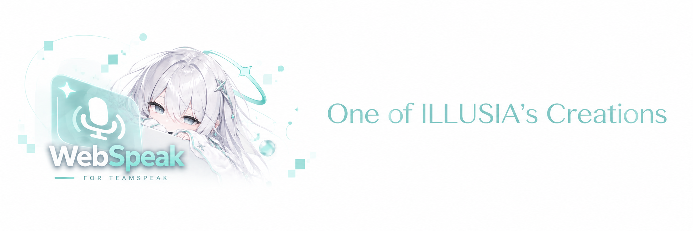
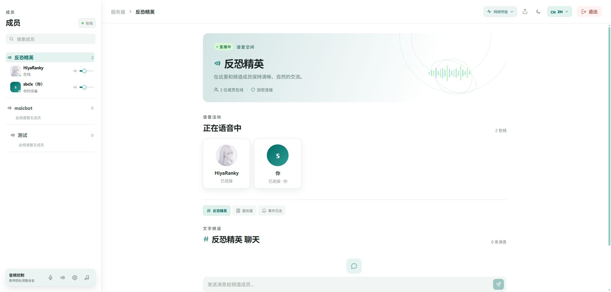
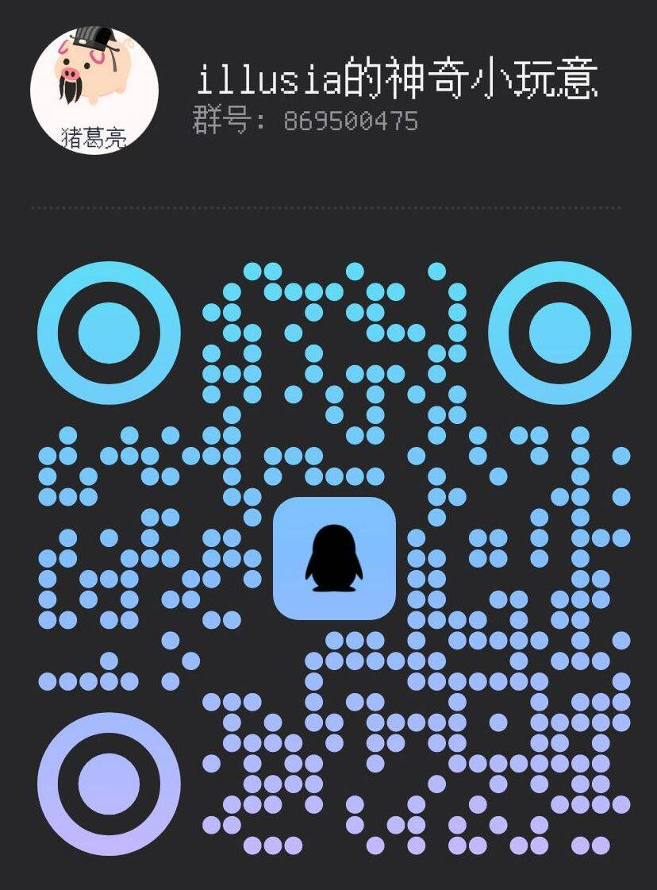

<a id="readme-top"></a>

<div align="center">
  <a href="https://github.com/EchoSixHIYA/WebSpeak-client-for-TeamSpeak"></a>
  <h1>WebSpeak</h1>
  <p><strong>打开浏览器，就能加入你的 TeamSpeak。</strong></p>
  <p>A self-hosted browser voice client for TeamSpeak 3 &amp; TeamSpeak 6.</p>
  <p>
    <a href="https://github.com/EchoSixHIYA/WebSpeak-client-for-TeamSpeak/releases/latest"></a>
    <a href="https://github.com/EchoSixHIYA/WebSpeak-client-for-TeamSpeak/actions/workflows/ci.yml"></a>
    <a href="./LICENSE"></a>
    <a href="https://github.com/EchoSixHIYA/WebSpeak-client-for-TeamSpeak/stargazers"></a>
  </p>
  <p>
    <a href="./docs/README.zh-CN.md">简体中文</a> · <a href="./docs/README.en.md">English</a> · <a href="./docs/README.de.md">Deutsch</a> · <a href="./docs/README.ru.md">Русский</a> · <a href="./docs/README.ja.md">日本語</a>
  </p>
  <p>
    <a href="#live-demo">在线演示 · Live demo</a> · <a href="#quick-start">快速部署 · Quick start</a> · <a href="#documentation">文档 · Docs</a> · <a href="https://github.com/EchoSixHIYA/WebSpeak-client-for-TeamSpeak/issues">反馈 · Issues</a>
  </p>
</div>

当前版本 / Current version: **[v0.3.0](https://github.com/EchoSixHIYA/WebSpeak-client-for-TeamSpeak/releases/tag/v0.3.0)** · [更新内容 / Release notes](./docs/README.zh-CN.md#latest-release-notes)

## 关于 WebSpeak · Overview

WebSpeak 将 TeamSpeak 3 / TeamSpeak 6 带到浏览器：无需安装桌面客户端，即可加入语音频道、发送消息和分享屏幕。你可以自行部署网关，并通过网页后台管理服务器、访问策略、皮肤和运行数据。

Join voice channels, chat and share your screen from a browser. Deploy your own gateway and keep control of your TeamSpeak targets, access policy, skins and data through the web administration console.

| 能力 · Capability | 说明 · Highlights |
| --- | --- |
| 🎙️ 语音 · Voice | Opus、可选 WebRTC、WebSocket 回退、降噪与成员音量 / Opus, optional WebRTC, fallback, noise suppression and per-member volume |
| 💬 频道与聊天 · Channels & chat | 实时频道树、成员状态、私聊与本地历史 / Live channel tree, member state, private chat and local history |
| 🖥️ 屏幕共享 · Screen sharing | 浏览器之间及与受支持的 TS6 客户端互通 / Between browsers and supported native TS6 clients |
| 🎨 皮肤 · Skins | `.wskin` 外观、布局和小组件，支持 GitHub 分发 / Portable appearance, layouts and widgets, distributed through GitHub |
| 🛠️ 管理 · Administration | 目标、邀请、中继、备份和可选 TS 管理 / Targets, invites, relays, backups and optional TS management |
| 🌍 自托管 · Self-hosting | 五种语言、响应式界面、多架构部署 / Five languages, responsive layouts and multi-architecture deployment |

<a id="live-demo"></a>

## 在线演示 · Live demo

| 节点 · Region | 地址 · Address |
| --- | --- |
| 上海 · Shanghai | [shanghai.webspeak.online](https://shanghai.webspeak.online) |
| 香港 · Hong Kong | [webspeak.online](https://webspeak.online) |



<details>
<summary>更多界面与语言 · More screenshots & languages</summary>

- [简体中文](./docs/README.zh-CN.md#screenshots) · [English](./docs/README.en.md#screenshots) · [Deutsch](./docs/README.de.md#screenshots) · [Русский](./docs/README.ru.md#screenshots) · [日本語](./docs/README.ja.md#screenshots)
- 日间、夜间、ILLUSIA、KAAK 与社区皮肤 / Day, Night, ILLUSIA, KAAK and community skins

</details>

<a id="quick-start"></a>

## 快速部署 · Quick start

在 Linux Docker 主机上运行 / On a Linux Docker host:

```bash
git clone --depth 1 https://github.com/EchoSixHIYA/WebSpeak-client-for-TeamSpeak.git
cd WebSpeak-client-for-TeamSpeak
docker compose pull
docker compose up -d
```

1. 打开 `http://127.0.0.1:3040/admin`，使用 `admin` / `admin` 登录并设置至少 12 位新密码。Open the console, sign in and replace the default password.
2. 配置 TeamSpeak 目标和访问模式；公网使用 HTTPS。Set the TeamSpeak target and access mode; use HTTPS for public access.
3. 启用 WebRTC 时放行配置的 UDP 范围，默认 `40000–40099`。Allow the configured UDP range when enabling WebRTC.

数据保存在 `webspeak-data` volume，升级时保留它。以上 Compose 使用主机网络；Windows 服务端可选择[发布包](https://github.com/EchoSixHIYA/WebSpeak-client-for-TeamSpeak/releases/latest)。完整说明：[中文部署指南](./docs/README.zh-CN.md#deployment) · [English deployment guide](./docs/README.en.md#deployment)。

Data persists in the `webspeak-data` volume. The Compose file uses host networking. Windows x64 and Linux x64/ARM64 release packages include the runtime; Docker images support amd64/arm64.

<a id="documentation"></a>

## 文档 · Documentation

- [简体中文](./docs/README.zh-CN.md)
- [English](./docs/README.en.md)
- [Deutsch](./docs/README.de.md)
- [Русский](./docs/README.ru.md)
- [日本語](./docs/README.ja.md)
- [皮肤开发指南 / Skin development guide](./docs/SKIN_DEVELOPMENT.md)
- [皮肤开发 Agent Skill / Skin Development Agent Skill](./.agents/skills/webspeak-skin-development/SKILL.md)

## 扩展生态 · Extensions

| 类型 · Type | 入口 · Resources |
| --- | --- |
| 皮肤包 · Skin packages | [皮肤索引 · Catalog](https://github.com/Huddle-Up-Forge/webspeak-skins) · [Discord Voice](https://github.com/Huddle-Up-Forge/webspeak-skin-discord-voice) |
| 功能插件 · Functional plugins | [应用目录与开发起点 · Catalog & application starter](https://github.com/Huddle-Up-Forge/webspeak-plugin) · [开发指南 · Guide](./docs/PLUGIN_DEVELOPMENT.md) · [Agent Skill](./.agents/skills/webspeak-plugin-development/SKILL.md) |

皮肤包负责界面、布局及其附属小组件；功能插件使用标准浏览器环境和可选 Node 后端，自行实现业务功能。功能插件 API v2 已包含在 v0.3.0 中，提供独立于皮肤的悬浮应用入口。

Skins own appearance, layout and attached widgets. Functional plugin API v2 is included in v0.3.0 with a skin-independent floating application workspace.

## 社区 · Community

[GitHub Issues](https://github.com/EchoSixHIYA/WebSpeak-client-for-TeamSpeak/issues) · [QQ 群 · QQ group `869500475`](http://qm.qq.com/cgi-bin/qm/qr?_wv=1027&k=yhumUMDD9PmyYFWdXWUb_x7hM5trFQY8&authKey=Pw3HBGT7GwMinTQnuFGfnpf0aRSzXOJKcAiujVP1%2BXMpjheAKrncTRivicBJxpjV&noverify=0&group_code=869500475) · [Telegram](https://t.me/+8qShpTcuN9A3MWY9)

<details>
<summary>QQ群二维码 · QQ group QR code</summary>

<p align="center"><a href="http://qm.qq.com/cgi-bin/qm/qr?_wv=1027&k=yhumUMDD9PmyYFWdXWUb_x7hM5trFQY8&authKey=Pw3HBGT7GwMinTQnuFGfnpf0aRSzXOJKcAiujVP1%2BXMpjheAKrncTRivicBJxpjV&noverify=0&group_code=869500475"></a></p>

</details>

### 相关项目 · Related projects

[NeteaseTSBot](https://github.com/yichen11818/NeteaseTSBot) — 面向 TeamSpeak 3/6 的音乐机器人，支持网易云音乐、QQ 音乐、Bilibili 和 Web 控制台。A TeamSpeak music bot with Netease Cloud Music, QQ Music, Bilibili and a web console.

## 贡献者 · Contributors

感谢协议 SDK 作者、代码与文档贡献者，以及独立皮肤的原始作者。Thanks to the SDK author, code and documentation contributors, and original skin authors.

<details>
<summary>查看贡献说明 · View contribution credits</summary>

- [HoneyBBQ](https://github.com/HoneyBBQ) — 上游 [teamspeak-js（`@honeybbq/teamspeak`）](https://github.com/HoneyBBQ/teamspeak-js) SDK 的作者，为 WebSpeak 提供底层 TeamSpeak 协议客户端能力。
- [ph1gros](https://github.com/ph1gros) — 在 [PR #48](https://github.com/EchoSixHIYA/WebSpeak-client-for-TeamSpeak/pull/48) 中报告并提供公开目标 IPv6 校验、管理员认证与会话、代理限流和 PCM 上行边界的安全审查、补丁及回归测试；相关问题由项目在 `dev` 分支重新实现并修复。Security findings, proposed fixes and regression tests; reimplemented on `dev`.
- [LainHE](https://github.com/LainHE) — [已合并 PR #2、#8、#28、#31–#35、#37、#38、#40](https://github.com/EchoSixHIYA/WebSpeak-client-for-TeamSpeak/pulls?q=is%3Apr+is%3Amerged+author%3ALainHE)，涉及浏览器报错翻译、缩放与首页布局、屏幕共享码率与观看者头像、中继目标校验与异常重连、可信代理校验、连接失败传递、音频故障报告及 WebRTC 失败时的资源清理。
- [TimmySheep](https://github.com/TimmySheep) — [已合并 PR #13、#15–#24](https://github.com/EchoSixHIYA/WebSpeak-client-for-TeamSpeak/pulls?q=is%3Apr+is%3Amerged+author%3ATimmySheep)，涉及 TS6 既有屏幕共享发现、屏幕比例、移动端语音/常亮/皮肤菜单、身份频道选项、PWA/主题、聊天历史、成员音频状态和麦克风权限等改进。
- [yichen11818](https://github.com/yichen11818) — [PR #25](https://github.com/EchoSixHIYA/WebSpeak-client-for-TeamSpeak/pull/25) 支持 TeamSpeak 注册昵称连接并保留昵称目标；[PR #51](https://github.com/EchoSixHIYA/WebSpeak-client-for-TeamSpeak/pull/51) 改进 KAAK 首次连接后的工作区保留与重连；[PR #27](https://github.com/EchoSixHIYA/WebSpeak-client-for-TeamSpeak/pull/27) 和 [PR #52](https://github.com/EchoSixHIYA/WebSpeak-client-for-TeamSpeak/pull/52) 提供 Discord 皮肤的原始设计与实现（提交署名 **yumi**），后由 WebSpeak 项目移植为[独立分发的 `.wskin` 皮肤](https://github.com/Huddle-Up-Forge/webspeak-skin-discord-voice)。

</details>

## 许可证 · License

WebSpeak 使用 [AGPL-3.0-only](./LICENSE) 发布。第三方依赖的许可与归属见各自项目。

WebSpeak is distributed under [AGPL-3.0-only](./LICENSE). Third-party dependencies retain their respective licenses and attribution.

<details>
<summary>Star History</summary>

<a href="https://star-history.com/#EchoSixHIYA/WebSpeak-client-for-TeamSpeak&amp;Date"></a>

</details>

<p align="right"><a href="#readme-top">返回顶部 · Back to top ↑</a></p>
