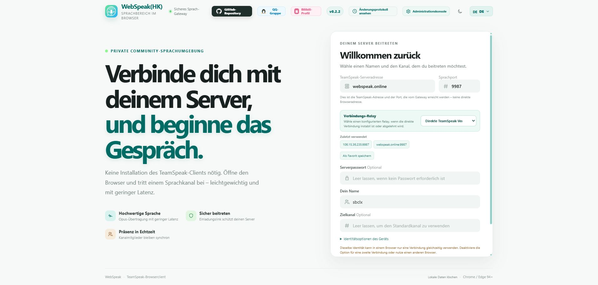
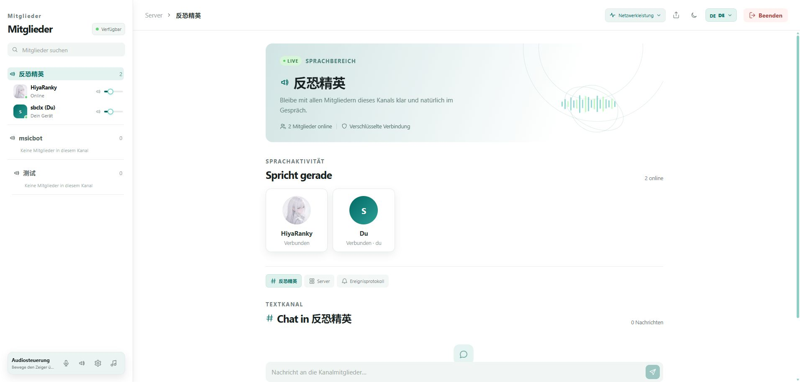
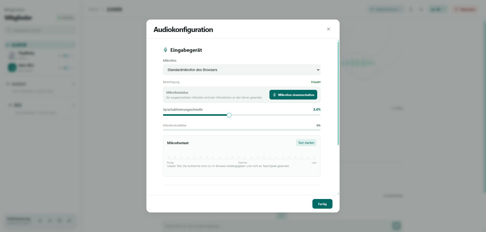
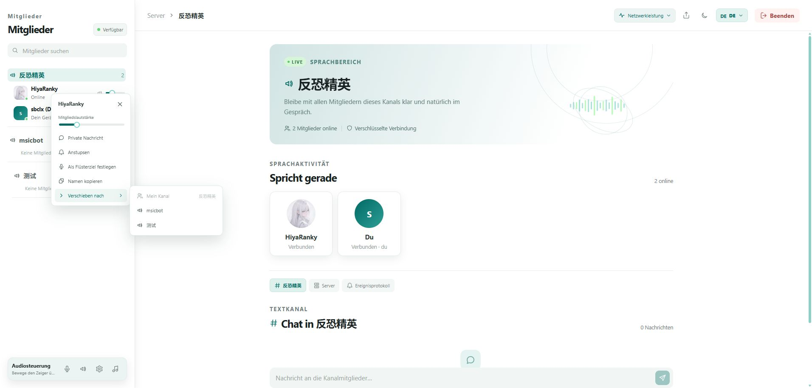

# WebSpeak · Deutsch

[Projektstartseite](../README.md) · [简体中文](./README.zh-CN.md) · [English](./README.en.md) · [Русский](./README.ru.md) · [日本語](./README.ja.md)

WebSpeak ist ein selbst gehosteter Webclient und ein Sprach-Gateway für TeamSpeak 3 und TeamSpeak 6. Nutzer können ohne Desktop-Client im Browser Kanälen beitreten; Administratoren verwalten Zielserver, Zugriff und Laufzeitstatus über die Webkonsole.

Aktuelle Version: [v0.2.9](https://github.com/EchoSixHIYA/WebSpeak-client-for-TeamSpeak/releases/tag/v0.2.9).

## Live-Demo

- Shanghai: <https://shanghai.webspeak.online>
- Hongkong: <https://webspeak.online>

Netzwerkbedingungen und Auslastung können bei beiden Demos schwanken; Latenz, Verbindungsabbrüche oder kurze Ausfälle beschreiben nicht jede eigene Bereitstellung.

## ✨ Funktionen

| Funktion | Beschreibung |
| --- | --- |
| TeamSpeak-Kompatibilität | Unterstützt TeamSpeak 3 und TeamSpeak 6 und erkennt das Zielprotokoll anhand der gemeldeten Version automatisch. |
| Plattformübergreifendes P2P-Bildschirmteilen | Browsernutzer und native TeamSpeak-6-Clients können die Bildschirmfreigabe gegenseitig starten und ansehen; WebRTC/ICE überträgt Medien direkt, WebSpeak leitet nur die Signalisierung weiter. |
| IPv6-Ziele | IPv6-TeamSpeak-Ziele und über DNS aufgelöste IPv6-Adressen werden standardmäßig unterstützt. |
| Kanäle und Mitglieder | Kanalstruktur und aktuelle Mitglieder anzeigen und Kanäle wechseln. |
| Echtzeit-Sprache | Opus-Audio mit kompatiblem Transport und optional integriertem WebRTC für geringere Latenz. |
| Audiosteuerung | Mikrofon und Lautsprecher auswählen, Lautstärke regeln, testen, stummschalten, VOX und individuelle Mitgliedslautstärke. |
| Browserseitige Geräuschunterdrückung | Optionale Mikrofon-Geräuschunterdrückung in der Browseraufnahme, ohne zusätzliche serverseitige Audioverarbeitung. |
| Nachrichten und Aktionen | Kanal- und Serverchat, private Nachrichten, Anstupsen und Flüsterziele. |
| Desktop-Begleitton | Audio eines freigegebenen Fensters oder Browser-Tabs im aktuellen Kanal teilen. |
| Identität und Zugriff | Gespeicherte Identität, eigene Ziele, widerrufbare Einladungen sowie Import, Konvertierung, Prüfung und Export von TeamSpeak-3-Identitäten. |
| Administration | Ziele, Zugriff, öffentliche Medienadresse, IPv6-Kandidaten, Sprach-STUN, Relays, Einladungen, Sitzungen, Protokolle, Diagnosen und Backups verwalten. |
| Projektstruktur | In 0.2.6 wurden Sprach-Gateway, Sitzungsereignisse, Audio und Bildschirmfreigabe in Module aufgeteilt; Sprach- und Admin-Oberflächen in Komponenten, Composables und Dienste zerlegt und um Lebenszyklus- und Wiederverbindungstests ergänzt. |
| Skins | Geschützte Tages-, Nacht- und ILLUSIA-Skins sowie instanzverwaltete `.wskin`-Designs mit Aktivierungs- und Standardauswahl im Adminbereich. |
| Oberfläche | Chinesische, englische, deutsche, russische und japanische Oberfläche sowie responsive Desktop-/Mobilansicht. |
| Selbsthosting | Daten bleiben beim Betreiber; Pakete für Windows x64 und Linux x64/ARM64, Docker für amd64/arm64 und Android-APKs für arm64-v8a, armeabi-v7a und x86_64. |

## TeamSpeak-Versionskompatibilität

Sprachverbindungen verwenden das TeamSpeak-Clientprotokoll und benötigen keine Query-Zugangsdaten. Die optionale TS-Verwaltung verwendet eigene WebQuery-/ServerQuery-Zugangsdaten.

- **TeamSpeak 3**: Die Erkennung wertet die führende `3.x`-Versionsnummer aus. Ältere Serverversionen sollten in der jeweiligen Umgebung geprüft werden, da nicht jede historische Version separat getestet wurde.
- **TeamSpeak 6**: Unterstützt, einschließlich Bildschirmfreigabe mit nativen TeamSpeak-6-Clients.
- **Automatische Erkennung**: Das Gateway liest die `version`-Antwort des Servers und hält das erkannte Protokoll in der Verbindungsdiagnose fest.
- Das Gateway verwendet das Upstream-SDK 1.0 [`@honeybbq/teamspeak`](https://github.com/HoneyBBQ/teamspeak-js); WebSpeak richtet sich an TeamSpeak 3 und 6.

## Optionale TeamSpeak-Verwaltung

WebSpeak-Verwaltung und Sprachverbindungen sind davon unabhängig. Im Modus mit festem Server die TS-Verbindung unter `/admin/ts-admin` einrichten.

1. WebQuery auf dem TS-Server aktivieren und einen berechtigten TS-Administrator einen API-Schlüssel erstellen lassen. HTTP-/HTTPS-URL von WebQuery und Schlüssel eintragen. Gemeint ist der TS-Query-Dienst, nicht die WebSpeak-Webseite. Unterstützt werden TS3 ab 3.12 und TS6.
2. Virtuelle Server-ID `0` wählt anhand des festen Sprachports aus. Bei eingeschränkten Schlüsseln die freigegebene Server-ID eintragen. Änderungen erfordern einen schreibbaren Geltungsbereich und entsprechende TS-Rechte; Leseschlüssel dienen zur Anzeige.
3. Alternativ ServerQuery SSH oder bei TS3 ServerQuery TCP wählen. Query-Host (leer: festes Ziel), Query-Port, Benutzername und Passwort eintragen; SSH benötigt einen vertrauenswürdigen Hostschlüssel-Fingerabdruck. Dies ist kein SSH-Zugang zum Betriebssystem. TCP ist unverschlüsselt und nur für vertrauenswürdige Netze geeignet. HTTPS-Zertifikate müssen vom Gateway als vertrauenswürdig erkannt werden.
4. Speichern und verbinden oder aktualisieren. Verfügbar sind Servereinstellungen, Kanalverwaltung, Verschieben/Ausschließen/Sperren von Mitgliedern, Gruppenzuweisung und Entsperren. Aktionen benötigen Bestätigung und TS-Rechte; Listen werden manuell aktualisiert.

Zugangsdaten werden serverseitig verschlüsselt und nie von der API zurückgegeben. Datenbank und `master.key` gemeinsam sichern. Verbindungsfehler beeinflussen weder WebSpeak-Verwaltung noch Sprache. Sperren verwenden die Benutzer-UID, damit andere Nutzer derselben Gateway-IP nicht betroffen sind.

## 🖼️ Screenshots

Die Screenshots zeigen die deutsche Willkommensseite, den Sprachbereich, die Audiosteuerung und das Mitgliedermenü.

### Willkommensseite

<p align="center"></p>

### Sprachbereich

<p align="center"></p>

### Audiosteuerung

<p align="center"></p>

### Mitgliedermenü

<p align="center"></p>

## 🧩 Erweiterte Funktionen

Diese Funktionen sind optional. Ohne sie arbeitet WebSpeak weiterhin mit dem kompatiblen Sprachtransport. Die Einstellungen befinden sich unter **Administration → Server** und gelten für neue Verbindungen.

### 1. WebRTC-Sprache mit niedriger Latenz

WebRTC verwendet für Browser-Sprache einen Echtzeit-Medienpfad und ermöglicht außerdem Desktop-Begleitton. Das aktuelle WebSpeak-Gateway stellt WebRTC selbst bereit; ein zusätzlicher Medienserver ist nicht erforderlich.

1. Unter `/admin` anmelden und auf der Seite **Server** die **Erweiterten Einstellungen** öffnen.
2. Bei deaktiviertem WebRTC Start- und Endport für UDP festlegen. Der Standardbereich ist `40000–40099`.
3. Den gesamten UDP-Bereich in Sicherheitsgruppe und Firewall des WebSpeak-Hosts freigeben.
4. **WebRTC** aktivieren und speichern. Nicht unterstützte Browser oder Netzwerke wechseln automatisch zum kompatiblen Transport.

Der Portbereich ist bei aktiviertem WebRTC gesperrt. Zum Ändern WebRTC zuerst deaktivieren und speichern, danach die Firewall-Regeln anpassen. Für öffentliche Bereitstellungen ist HTTPS erforderlich.

### ICE-Kandidaten für Bildschirmfreigabe

Die Medien der Bildschirmfreigabe versuchen weiterhin eine direkte Browser-zu-Browser-Verbindung; WebSpeak leitet nur die Signalisierung weiter. Standardmäßig werden die öffentlichen TeamSpeak-STUN-Dienste zur Ermittlung öffentlicher Kandidaten verwendet. STUN überträgt keine Medien. Ein autorisierter externer TURN-Dienst kann über `WEBSPEAK_SCREEN_SHARE_ICE_SERVERS` als JSON-Array konfiguriert werden, zum Beispiel:

```json
[{"urls":"stun:turn.teamspeak.com:3478"},{"urls":"turns:turn.example.com:5349","username":"<username>","credential":"<credential>"}]
```

Mit TURN kann die Medienübertragung diesen externen Dienst verwenden, aber niemals das WebSpeak-Gateway. Ohne TURN werden nur direkte ICE-Pfade und STUN verwendet.

### Plattformübergreifendes P2P-Bildschirmteilen

Browsernutzer und native TeamSpeak-6-Clients können Bildschirmfreigaben gegenseitig erkennen, starten und ansehen. Zwischen Browsern sowie zwischen Browser und nativem Client werden die Bildschirmmedien möglichst über eine direkte WebRTC/ICE-Peer-to-Peer-Verbindung übertragen; WebSpeak übernimmt Sitzungsberechtigung, Freigabestatus und SDP-/ICE-Signalisierung, transportiert aber keine Bildschirmmedien. Die Oberfläche zeigt Live-Status und Zuschauerzahl und bietet Lautstärke-, Vollbild- und Beenden-Steuerung. Für die Aufnahme stehen bis zu 1080p und 60 FPS sowie WebRTC-Statistiken zur Verfügung.

### 2. Relay-Modus

Ein Relay hilft, wenn ein TeamSpeak-Server Verbindungen aus einer anderen Region ablehnt oder der direkte Weg instabil ist. Es ist kein VPN, sondern leitet nur den TeamSpeak-Verkehr der aktuellen WebSpeak-Sitzung weiter.

Eine Relay-Instanz betreibt sowohl die ältere UDP-Kompatibilitätsweiterleitung als auch ein separates Sprach-Gateway, jedoch keine Besucher- oder Administrationsseite. Das Eingangs-Gateway signiert mit dem gemeinsamen Token ein einmaliges Sprach-Ticket und delegiert es; anschließend verbindet sich der Browser direkt mit dem Relay, das seinerseits TeamSpeak erreicht. Die Seite bleibt unter der URL des Eingangs-Gateways. Ein zufälliges Token mit mindestens 16 Zeichen verwenden.

#### Aus dem Quellcode starten

```bash
git clone --depth 1 https://github.com/EchoSixHIYA/WebSpeak-client-for-TeamSpeak.git
cd WebSpeak-client-for-TeamSpeak
npm ci --ignore-scripts
npm run build
WEBSPEAK_MODE=relay \
WEBSPEAK_RELAY_TOKEN='replace-with-a-long-random-token' \
WEBSPEAK_RELAY_HOST='0.0.0.0' \
WEBSPEAK_RELAY_PORT='39087' \
node dist/index.js
```

Windows PowerShell:

```powershell
$env:WEBSPEAK_MODE = "relay"
$env:WEBSPEAK_RELAY_TOKEN = "replace-with-a-long-random-token"
$env:WEBSPEAK_RELAY_HOST = "0.0.0.0"
$env:WEBSPEAK_RELAY_PORT = "39087"
node .\dist\index.js
```

#### Aus einem Release-Paket starten

Das passende Paket aus den [Releases](https://github.com/EchoSixHIYA/WebSpeak-client-for-TeamSpeak/releases/latest) herunterladen und entpacken:

```bash
# Linux
export WEBSPEAK_MODE=relay
export WEBSPEAK_RELAY_TOKEN='replace-with-a-long-random-token'
export WEBSPEAK_RELAY_HOST='0.0.0.0'
export WEBSPEAK_RELAY_PORT='39087'
./runtime/node ./dist/index.js
```

Unter Windows PowerShell dieselben Variablen setzen und `.\runtime\node.exe .\dist\index.js` ausführen.

#### Mit Docker starten

```bash
docker run -d --name webspeak-relay --restart unless-stopped --network host \
  -e WEBSPEAK_MODE=relay \
  -e WEBSPEAK_RELAY_TOKEN='replace-with-a-long-random-token' \
  -e WEBSPEAK_RELAY_PORT='39087' \
  ghcr.io/echosixhiya/webspeak:latest
```

Das Sprach-Gateway lauscht standardmäßig auf `127.0.0.1:3041`. Eine HTTPS-Domain für das Relay einrichten und sie mit Caddy oder einem vergleichbaren Proxy an `127.0.0.1:3041` weiterleiten, zum Beispiel:

```caddyfile
relay.example.com {
  reverse_proxy 127.0.0.1:3041
}
```

In den Relay-Einstellungen des Eingangs-Gateways als **Voice gateway address** diesen HTTPS-Ursprung eintragen, etwa `https://relay.example.com`. Die Seite bleibt auf ihrem ursprünglichen Gateway und öffnet danach eine WSS-Verbindung zum Relay. WebRTC ist auf dem Relay standardmäßig aktiviert. Zusätzlich UDP `40000-40099` freigeben und `WEBSPEAK_RELAY_WEBRTC_PUBLIC_HOST` auf eine öffentliche Relay-IP oder direkt erreichbare Domain setzen. Bei geänderter WebRTC-Portspanne auch die Firewall anpassen. UDP `39087` für ältere Kompatibilitätsweiterleitungen offen lassen.

#### Im Gateway aktivieren

1. **Administration → Server → Relay-Server** öffnen und einen oder mehrere Knoten hinzufügen.
2. Anzeigename, UDP-Endpunkt wie `relay.example.com#39087`, HTTPS-Ursprung des Sprach-Gateways wie `https://relay.example.com` und das passende Token eintragen und speichern.
3. Besucher können auf der Willkommensseite Direktzugriff oder einen konfigurierten Relay-Knoten auswählen.

Relay deaktivieren und speichern, um die Option von der Willkommensseite zu entfernen.

### 3. Abhängigkeiten und Hinweise zur Herkunft

- Der Relay-Dienst ist Bestandteil von WebSpeak und verwendet Node.js-Standardbibliotheken; GOST, sing-box oder ein anderes Proxy-Framework werden nicht verwendet.
- WebRTC verwendet [werift](https://github.com/shinyoshiaki/werift-webrtc) `0.24.4`; das Upstream-Projekt steht unter MIT-Lizenz.
- Die TeamSpeak-Verbindung verwendet das Upstream-SDK [HoneyBBQ/teamspeak-js](https://github.com/HoneyBBQ/teamspeak-js), veröffentlicht als `@honeybbq/teamspeak@1.0.0-beta.19`; der SDK-Fork des Projekts muss nicht mehr gebaut werden.

## 🧾 Änderungsprotokoll

<a id="latest-release-notes"></a>

### [v0.2.9](https://github.com/EchoSixHIYA/WebSpeak-client-for-TeamSpeak/releases/tag/v0.2.9) · 2026-10-24

#### Erweiterungen

- Umstellung auf das Upstream-SDK 1.0.0-beta.19. Normale Sprachverbindungen verwenden das Live-Clientverzeichnis ohne Query-Listenberechtigungen.
- Neuer GitHub-Skin-Store mit Installation, Updates und Freigabe pro Instanz. Discord Voice wird als eigenständiges standardkonformes `.wskin`-Beispiel verteilt.
- Optionale TS-Verwaltung im Modus mit festem Server: WebQuery-, TCP- oder SSH-Query-Zugangsdaten ermöglichen die Verwaltung von Server, Kanälen, Mitgliedern, Servergruppen und Sperren.
- Relays können einen direkten Sprachendpunkt für Browser bereitstellen und die Sprachsitzung übernehmen; eine zusätzliche Weiterleitung zwischen Gateways entfällt.
- Allgemeine Schnittstellen zum Beibehalten des Arbeitsbereichs und zur Wiederverbindung; KAAK nutzt diese und bietet Zugänge zur Administration, zum Projekt-GitHub und zur QQ-Gruppe.
- Unterstützung für TeamSpeak-Kanaltrenner mit Ausrichtung, Wiederholung, Leerzeilen und Standardlinien sowie öffentlichen Darstellungsdaten für Skins.

#### Fehlerbehebungen

- Vollbildgröße der Bildschirmfreigabe und Bereinigung von Status und Wiedergaberessourcen ausgeschiedener Mitglieder korrigiert.
- Erfolgreiche Sperren werden nicht mehr als Fehler gemeldet; Query-Verbindungen zählen nicht als Mitglieder, und das Kanalpasswort ist korrekt beschriftet.
- Berechtigungs-, Ratenlimit- und Zeitüberschreitungsfehler werden unterschieden. Schlägt nur die Aktualisierung nach einer erfolgreichen Aktion fehl, erscheint eine eigene Warnung gegen doppelte Ausführung.
- Verhindert, dass das SDK fehlgeschlagene HTTP-Antworten als erfolgreiche WebQuery-Ergebnisse behandelt; Layoutfehler auf der DC-Startseite, im Chat und bei schmalen Ansichten behoben.

#### Bekannte Probleme

- Die in [PR #48](https://github.com/EchoSixHIYA/WebSpeak-client-for-TeamSpeak/pull/48) beschriebene Sicherheitsabsicherung ist nicht enthalten; das Schließen des PRs bedeutet nicht, dass die gemeldeten Probleme behoben sind.

### [v0.2.8](https://github.com/EchoSixHIYA/WebSpeak-client-for-TeamSpeak/releases/tag/v0.2.8) · 2026-10-17

#### Bildschirmfreigabe und Verbindungsstabilität

- Aushandlung und Verarbeitung der Videospur für Bildschirmfreigaben zwischen Browsern und nativen TeamSpeak-Clients korrigiert.
- Schnelle Kanalwechsel werden zuverlässiger verarbeitet, um inkonsistente Clientzustände zu vermeiden.
- Darstellungsfehler in einigen Skin-Komponenten und der KAAK-Übersetzung behoben.

#### Verbesserungen der Oberfläche

- Audiogerätenamen werden vollständig angezeigt und bei wenig Platz umgebrochen, damit lange Namen unterscheidbar bleiben.
- Unbeabsichtigte Textauswahl des Avatar-Platzhalters behoben.

### [v0.2.7](https://github.com/EchoSixHIYA/WebSpeak-client-for-TeamSpeak/releases/tag/v0.2.7) · 2026-10-13

#### Offeneres Skin-System

- Ein offenerer Skin-Editor und die zugehörige Laufzeit erlauben es nun, Stil und Position beliebiger Komponenten anzupassen und Widgets hinzuzufügen.
- Öffne nach dem Wechsel in den Sprachbereich im selben Browser ein neues Fenster mit der Administrationsoberfläche und melde dich an, um den Skin-Editor zu aktivieren.
- Der Skin „KAAK“ ist als Entwicklungsbeispiel enthalten.
- Der Agent Skill für die Skin-Entwicklung wurde aktualisiert.

#### Funktionserweiterungen

- Serveradressen können nun über SRV-Einträge und TeamSpeak-Nickname-Einträge aufgelöst werden.
- Im freien Modus lassen sich mehrere Server-Tabs verwalten; diese Schaltflächen sind im Modus „Fester Server“ nicht verfügbar.
- Eine Option für die Bitrate der Bildschirmfreigabe wurde hinzugefügt.
- WebSpeak speichert eingegebene Kanalpasswörter nun im Browser.
- Gesperrte Kanäle werden mit einem Schlosssymbol angezeigt.
- Der Chatverlauf wird nun dauerhaft gespeichert.

#### Fehlerbehebungen

- Fehler bei der Adressauflösung behoben.
- Fokuskonflikte zwischen Lautstärkeregelung und dem Ziehen von Mitgliedskarten behoben.
- Fehler behoben, durch den der Benutzerstatus fälschlich als unbekannt erkannt wurde.

### [v0.2.6](https://github.com/EchoSixHIYA/WebSpeak-client-for-TeamSpeak/releases/tag/v0.2.6) · 2026-10-08

Gegenüber 0.2.5 wurden Sprach-Gateway, gemeinsame Protokolle, Sprachoberfläche und Admin-Module umfassend umstrukturiert; #6/#7/#10 behoben, #9/#12 umgesetzt und der in PR #13 gemeldete Fall bereits aktiver TS6-Freigaben behoben. Opus- und Sitzungslebenszyklen sowie mobile Steuerung verbessert. Pakete: Windows x64, Linux x64/ARM64, Docker amd64/arm64 und Android arm64-v8a/armeabi-v7a/x86_64.

### [v0.2.5](https://github.com/EchoSixHIYA/WebSpeak-client-for-TeamSpeak/releases/tag/v0.2.5) · 2026-09-27

`.wskin`-Skins, Aktivierungs-/Standardverwaltung und geschützte Tages-, Nacht- und ILLUSIA-Skins ergänzt; unfertiges Aurora-Voice-Beispiel entfernt, Skin-Ladeblitze, dunkle Bedienelemente und Artwork-Ebenen im Sprachbereich korrigiert sowie offiziellen Skin-Entwicklungs-Agent-Skill hinzugefügt.

### [v0.2.4](https://github.com/EchoSixHIYA/WebSpeak-client-for-TeamSpeak/releases/tag/v0.2.4) · 2026-09-22

Plattformübergreifendes P2P-Bildschirmteilen zwischen Browsern und nativen TeamSpeak-6-Clients ergänzt; STUN-/externes-TURN-Konfiguration, Live-Player und Zuschauerstatus, Aufnahmeoptionen bis 1080p/60 FPS und WebRTC-Statistiken hinzugefügt; Bildschirmfreigabe-Interaktion verbessert und Besucherzählung ergänzt.

### [v0.2.3](https://github.com/EchoSixHIYA/WebSpeak-client-for-TeamSpeak/releases/tag/v0.2.3) · 2026-09-19

Mitgliederplanung und direkte Verschiebung nach Berechtigung ergänzt; Avatar-, Stummschaltstatus- und Identitätsunterstützung hinzugefügt; Screenshots und Dokumentation für alle fünf Sprachen aktualisiert.

### [v0.2.2](https://github.com/EchoSixHIYA/WebSpeak-client-for-TeamSpeak/releases/tag/v0.2.2) · 2026-09-17

Browserseitige Mikrofon-Geräuschunterdrückung, russische und japanische Oberfläche sowie sprachabhängige Begrüßungstexte ergänzt; Lautstärkeinteraktion und Fehlertexte/-codes auf Basis von PR #2 verbessert.

### [v0.2.1](https://github.com/EchoSixHIYA/WebSpeak-client-for-TeamSpeak/releases/tag/v0.2.1) · 2026-09-13

Verbindungsfehler auf der Willkommensseite verbessert, Fehlercodes erhalten und sicher gekürzt sowie IPv6-Ziele standardmäßig unterstützt.

### [v0.2.0](https://github.com/EchoSixHIYA/WebSpeak-client-for-TeamSpeak/releases/tag/v0.2.0) · 2026-09-10

Passwortabfrage, dedizierter Relay-Modus, Auswahl mehrerer Relays und Ursachendarstellung in der Administration ergänzt.

### [v0.1.8](https://github.com/EchoSixHIYA/WebSpeak-client-for-TeamSpeak/releases/tag/v0.1.8) · 2026-09-08

Docker-Bereitstellung vereinfacht, lokale TeamSpeak-Ziele unterstützt, 15-Sekunden-Timeout ergänzt und kontinuierliche Netzwerküberwachung eingeführt.

### [v0.1.7](https://github.com/EchoSixHIYA/WebSpeak-client-for-TeamSpeak/releases/tag/v0.1.7) · 2026-09-06

Deutsch, Telegram, Netzwerkleistung und Gesamtlautstärke ergänzt; Lautstärkeschwankungen beim Begleitton behoben.

### [v0.1.6](https://github.com/EchoSixHIYA/WebSpeak-client-for-TeamSpeak/releases/tag/v0.1.6) · 2026-09-04

Desktop-Begleitton, Hinweise zur gespeicherten Identität und Website-Symbol ergänzt; WebRTC-Mitgliederlautstärke korrigiert.

### [v0.1.5](https://github.com/EchoSixHIYA/WebSpeak-client-for-TeamSpeak/releases/tag/v0.1.5) · 2026-09-04

Identitätsspeicherung korrigiert und Designumschaltung verbessert.

### [v0.1.4](https://github.com/EchoSixHIYA/WebSpeak-client-for-TeamSpeak/releases/tag/v0.1.4) · 2026-09-03

WebRTC und Kanalchat korrigiert sowie Administration, Protokolle und Mobilansicht verbessert.

### [v0.1.3](https://github.com/EchoSixHIYA/WebSpeak-client-for-TeamSpeak/releases/tag/v0.1.3) · 2026-09-03

Integriertes WebRTC, aktualisiertes TeamSpeak-SDK und bessere Mitgliedersynchronisierung und Sprachpufferung.


## 🚀 Bereitstellung

| Methode | Geeignet für | Umgebung |
| --- | --- | --- |
| Docker Compose (empfohlen) | Dauerbetrieb, einfache Updates und persistente Daten | Docker Engine + Docker Compose |
| Release-Paket | Betrieb ohne Node.js und Build-Werkzeuge | Windows x64 oder Linux x64/ARM64 |
| Aus dem Quellcode | Entwicklung und Anpassungen | Node.js 22.12+, Git und native Build-Werkzeuge |

### Docker Compose (empfohlen)

```bash
git clone --depth 1 https://github.com/EchoSixHIYA/WebSpeak-client-for-TeamSpeak.git
cd WebSpeak-client-for-TeamSpeak
docker compose pull
docker compose up -d
```

Nach dem Start ist WebSpeak unter `http://<dein-host>:3040` erreichbar. Bei einem Reverse Proxy auf diese Adresse zeigen; für WebRTC den im Adminbereich angezeigten UDP-Bereich freigeben. Die Daten liegen im Volume `webspeak-data`.

```bash
docker compose ps
docker compose logs -f webspeak
```

Upgrade:

```bash
git pull --ff-only
docker compose pull
docker compose up -d
```

`docker compose down -v` nicht ausführen, da dadurch Datenbank und Administratoreinstellungen gelöscht werden.

### Release-Paket

Das passende `windows-x64.zip`, `linux-x64.tar.gz` oder `linux-arm64.tar.gz` aus den [GitHub Releases](https://github.com/EchoSixHIYA/WebSpeak-client-for-TeamSpeak/releases/latest) herunterladen und den enthaltenen Starter ausführen. Die Pakete enthalten Node.js und Produktionsabhängigkeiten. Docker unterstützt amd64/arm64.

Android-APKs für `arm64-v8a`, `armeabi-v7a` und `x86_64` sind ebenfalls verfügbar. Sie sind für Tests per Sideload debug-signiert, keine Google-Play-Pakete; echte TeamSpeak-Sprachtests auf Geräten stehen noch aus.

### Aus dem Quellcode

```bash
git clone https://github.com/EchoSixHIYA/WebSpeak-client-for-TeamSpeak.git
cd WebSpeak-client-for-TeamSpeak
npm ci --ignore-scripts
npm rebuild @discordjs/opus --foreground-scripts
npm --prefix web ci
npm --prefix web run build
npm run build
npm start
```

Für den Bau von `@discordjs/opus` werden Python, Make und eine C/C++-Toolchain benötigt.

### Erste Konfiguration

1. `http://<dein-host>:3040/admin` öffnen.
2. Mit `admin` / `admin` anmelden und sofort ein neues Passwort mit mindestens 12 Zeichen setzen.
3. Unter **Server** TeamSpeak-Ziel und Zugriffsmethode konfigurieren, zum Beispiel `voice.example.com#9987`.
4. Für öffentliche Nutzung HTTPS einrichten; bei aktiviertem WebRTC den im Adminbereich angezeigten UDP-Bereich freigeben.

## ⚠️ Voraussetzungen und Hinweise

| Bereich | Hinweis |
| --- | --- |
| Browser | Aktuelles Chrome, Edge oder ein moderner WebRTC-fähiger Browser wird empfohlen. Mikrofon- und Fenster-Audio benötigen normalerweise HTTPS. |
| TeamSpeak-Netzwerk | Der WebSpeak-Host muss den Zielserver erreichen können; der Standard-Sprachport ist `9987`. |
| Webnetzwerk | Der Dienst verwendet `3040/TCP`; öffentlich sollte ein HTTPS-Reverse-Proxy für Seite und WebSocket verwendet werden. |
| IPv6 | Literale Ziele als `[2001:db8::1]#9987` eintragen. Host/Container benötigen geroutetes IPv6, aktiviertes IPv6 in Betriebssystem und Node.js sowie passende Firewall-Regeln. |
| WebRTC | Standardbereich `40000–40099/UDP`; den gesamten Bereich freigeben und WebRTC vor einer Änderung deaktivieren. |
| Gespeicherte Identität | Eine Browseridentität kann nur eine aktive gespeicherte Verbindung halten. Für parallele Verbindungen deaktivieren oder ein anderes Browserprofil verwenden. |
| Begleitton | Nur auf dem Desktop verfügbar und WebRTC erforderlich. Bei Fenster- oder Tab-Freigabe auch Audio freigeben. |
| Daten | Docker verwendet `webspeak-data`; Release-Pakete und Quellcode verwenden `data/`. Vor Updates sichern. |
| Sitzungslimit | Eine Instanz akzeptiert bis zu 100 aktive Browser-Sitzungen. |

## Mitwirkende und Beiträge

Diese Liste würdigt den Autor des zugrunde liegenden SDKs, Beiträge aus zusammengeführten GitHub-PRs sowie ursprüngliche Arbeiten, die in eigenständig verteilte Skin-Pakete übernommen wurden.

- [HoneyBBQ](https://github.com/HoneyBBQ) — Autor des [teamspeak-js-SDKs (`@honeybbq/teamspeak`)](https://github.com/HoneyBBQ/teamspeak-js), das den von WebSpeak verwendeten TeamSpeak-Protokollclient bereitstellt.
- [LainHE](https://github.com/LainHE) — [zusammengeführte PRs #2, #8, #28, #31–#35, #37, #38 und #40](https://github.com/EchoSixHIYA/WebSpeak-client-for-TeamSpeak/pulls?q=is%3Apr+is%3Amerged+author%3ALainHE): Browser-Fehlerübersetzungen, Skalierung und Startseitenlayout, Bildschirmfreigabe-Bitrate und Zuschaueravatare, Relay-Zielprüfung und Wiederverbindung, vertrauenswürdige Proxys, Weitergabe von Verbindungsfehlern, Audio-Fehlermeldungen und Ressourcenfreigabe bei WebRTC-Fehlern.
- [TimmySheep](https://github.com/TimmySheep) — [zusammengeführte PRs #13 und #15–#24](https://github.com/EchoSixHIYA/WebSpeak-client-for-TeamSpeak/pulls?q=is%3Apr+is%3Amerged+author%3ATimmySheep) zu vorhandenen TS6-Freigaben, Seitenverhältnis, mobiler Sprache/Bildschirm-Wachhalten/Skin-Menü, Kanaloptionen der Identität, PWA/Design, Chatverlauf, Mitglieder-Audiozuständen und Mikrofonberechtigungen.
- [yichen11818](https://github.com/yichen11818) — [PR #25](https://github.com/EchoSixHIYA/WebSpeak-client-for-TeamSpeak/pull/25) ermöglichte Verbindungen über registrierte TeamSpeak-Nicknames und bewahrte Nickname-Ziele; [PR #51](https://github.com/EchoSixHIYA/WebSpeak-client-for-TeamSpeak/pull/51) verbesserte das Beibehalten des KAAK-Arbeitsbereichs und die Wiederverbindung nach der ersten Verbindung. [PR #27](https://github.com/EchoSixHIYA/WebSpeak-client-for-TeamSpeak/pull/27) und [PR #52](https://github.com/EchoSixHIYA/WebSpeak-client-for-TeamSpeak/pull/52) lieferten das ursprüngliche Design und die Implementierung des Discord-Skins (Commit-Autor **yumi**), die das WebSpeak-Projekt in einen [eigenständig verteilten `.wskin`-Skin](https://github.com/Huddle-Up-Forge/webspeak-skin-discord-voice) überführte.
