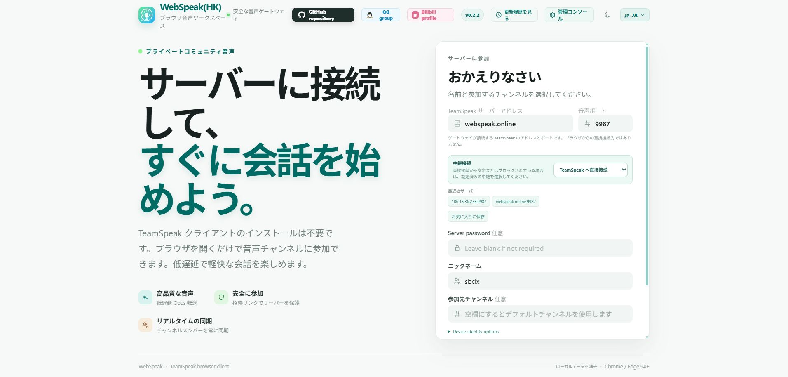
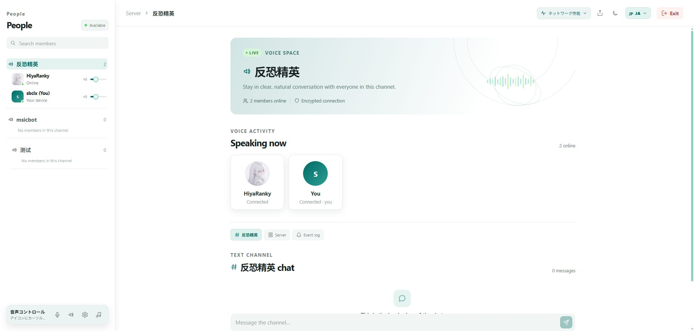
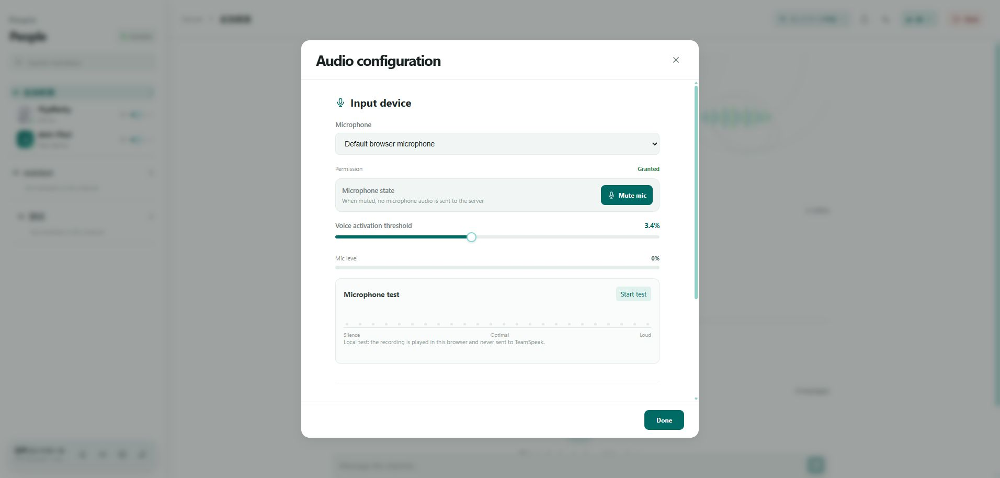
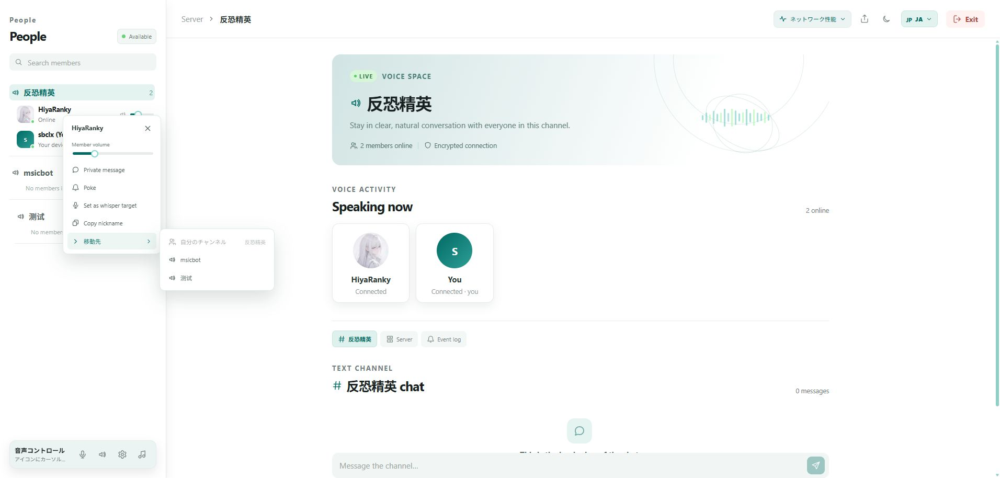

# WebSpeak · 日本語

[プロジェクトトップ](../README.md) · [简体中文](./README.zh-CN.md) · [English](./README.en.md) · [Deutsch](./README.de.md) · [Русский](./README.ru.md)

## プロジェクト概要

最新リリース：[v0.2.9](https://github.com/EchoSixHIYA/WebSpeak-client-for-TeamSpeak/releases/tag/v0.2.9)。

| 観点 | 説明 |
| --- | --- |
| **WHAT** | WebSpeak は TeamSpeak 3 / TeamSpeak 6 向けのセルフホスト型ブラウザクライアント兼音声ゲートウェイです。 |
| **WHY** | デスクトップクライアントをインストールせず、ブラウザからチャンネルに参加できます。運用者はサーバーとデータを管理できます。 |
| **HOW** | 起動後、管理コンソールで TeamSpeak の接続先とアクセス方針を設定します。ブラウザが画面と音声を担当し、WebSpeak がゲートウェイとして接続します。 |

## オンラインデモ

- 上海: <https://shanghai.webspeak.online>
- 香港: <https://webspeak.online>

各デモのネットワークや負荷は変動する場合があります。遅延、切断、一時的な利用不可は各自の環境での動作を示すものではありません。

## ✨ 機能

| 機能 | 説明 |
| --- | --- |
| TeamSpeak | TeamSpeak 3 / 6 に対応し、サーバーのバージョンから対象プロトコルを自動検出します。 |
| クロスプラットフォーム P2P 画面共有 | ブラウザユーザーと TeamSpeak 6 ネイティブクライアントが互いに画面共有を開始・視聴できます。メディアは WebRTC/ICE で直接送信し、WebSpeak はシグナリングだけを中継します。 |
| IPv6 | IPv6 の接続先と DNS から解決された IPv6 アドレスに標準対応します。 |
| チャンネルとメンバー | チャンネルツリー、リアルタイムのメンバー状態、チャンネル移動。 |
| リアルタイム音声 | Opus、互換トランスポート、内蔵 WebRTC による低遅延音声。 |
| 音声操作 | マイク、スピーカー、音量、VOX、ミュート、メンバーごとの音量調整。 |
| ブラウザ側ノイズ抑制 | マイクのノイズ抑制をブラウザの音声取得段階で任意に使用でき、サーバー側の追加処理は不要です。 |
| チャットと操作 | チャンネル/サーバーチャット、個人メッセージ、つつく、ウィスパー対象。 |
| BGM共有 | デスクトップブラウザで音声付きウィンドウやタブの音をチャンネルに共有。 |
| ID とアクセス | ID の保存、接続先の指定、期限・回数付き招待リンクに加え、TeamSpeak 3 ID のインポート、変換、検証、エクスポート。 |
| 管理コンソール | 接続先、アクセス、公開メディアアドレス、IPv6 候補、音声 STUN、中継、招待、セッション、ログ、診断、バックアップ。 |
| プロジェクト構造 | 0.2.6 では音声ゲートウェイ、セッションイベント、音声処理、画面共有調整を分割し、音声・管理画面をコンポーネント、composable、サービスに整理しました。ライフサイクルと再接続のテストも追加しました。 |
| スキン | 保護された昼・夜・ILLUSIA スキンに加え、管理者が有効化とデフォルトを管理するインスタンス `.wskin` に対応。 |
| インターフェース | 中文、English、Deutsch、Русский、日本語、レスポンシブ表示。 |
| デプロイ | Windows x64、Linux x64/ARM64 パッケージ、Docker amd64/arm64、Android arm64-v8a・armeabi-v7a・x86_64 APK。 |

## TeamSpeak のバージョン互換性

音声接続には標準の TeamSpeak クライアントプロトコルを使い、Query の認証情報は不要です。任意の TS 管理機能では、別途 WebQuery / ServerQuery の認証情報を使用します。

- **TeamSpeak 3**: 先頭の `3.x` バージョンを使ってプロトコルを判定します。すべての旧バージョンを個別に検証しているわけではないため、古いサーバーは実際の環境で確認してください。
- **TeamSpeak 6**: 対応しています。TeamSpeak 6 ネイティブクライアントとの画面共有も可能です。
- **自動検出**: ゲートウェイはサーバーの `version` 応答を読み取り、接続診断に判定結果を記録します。
- ゲートウェイは上流 SDK 1.0 の [`@honeybbq/teamspeak`](https://github.com/HoneyBBQ/teamspeak-js) を使用し、WebSpeak は TeamSpeak 3 と 6 を対象とします。

## 任意の TeamSpeak 管理

WebSpeak 管理画面と音声接続は、この機能に依存しません。固定サーバーモードで `/admin/ts-admin` を開き、TS 管理用の接続を設定します。

1. TS サーバーで WebQuery を有効にし、権限のある TS 管理者に API キーを作成してもらいます。WebQuery の HTTP/HTTPS URL とキーを入力します。WebSpeak のサイトではなく、TS Query サービスの URL です。TS3（3.12 以降）と TS6 に対応します。
2. 仮想サーバー ID `0` は固定接続先の音声ポートから選択します。制限付きキーでは許可された ID を入力してください。読み取りキーでは閲覧ができ、変更には書き込み可能なスコープと対応する TS 権限が必要です。
3. ServerQuery SSH、または TS3 の ServerQuery TCP も選べます。Query ホスト（空欄は固定接続先）、ポート、ユーザー名、パスワードを入力し、SSH では信頼できるホストキーのフィンガープリントも指定します。OS への SSH ログインではありません。TCP は暗号化されないため信頼できるネットワークで使用します。HTTPS 証明書はゲートウェイで信頼されている必要があります。
4. 保存して接続または更新します。サーバー設定、チャンネル管理、メンバーの移動・退出・ID による BAN、グループ割り当て、BAN 解除に対応します。操作には確認が必要で、TS が権限を検証します。リストは手動更新します。

認証情報はサーバーで暗号化され、API から返されません。データベースと `master.key` を一緒にバックアップしてください。管理接続の失敗は WebSpeak 管理画面や音声に影響しません。UID による BAN で同じゲートウェイ IP を使う他のユーザーへの影響を避けます。

## 🖼️ インターフェースのスクリーンショット

日本語のホーム、音声ワークスペース、オーディオ設定、メンバー操作メニューを掲載しています。

### ホーム

<p align="center"></p>

### 音声ワークスペース

<p align="center"></p>

### オーディオ設定

<p align="center"></p>

### メンバーメニュー

<p align="center"></p>

## 🧩 高度な機能

### WebRTC

**管理コンソール → サーバー → 詳細設定** で有効にします。無効の状態で UDP ポート範囲（初期値 `40000–40099`）を設定し、ファイアウォールで許可して保存してください。有効中は範囲がロックされ、新しい接続で WebRTC を使用します。非対応のブラウザは互換トランスポートに戻ります。公開サイトでは HTTPS が必要です。

### 画面共有の ICE 候補

画面共有のメディアは引き続きブラウザ間の直接接続を優先し、WebSpeak はシグナリングだけを中継します。初期状態では TeamSpeak の公開 STUN サービスで外部候補を検出します。STUN はメディアを運びません。認可済みの外部 TURN を使う場合は、起動前に `WEBSPEAK_SCREEN_SHARE_ICE_SERVERS` を JSON 配列で設定できます。

```json
[{"urls":"stun:turn.teamspeak.com:3478"},{"urls":"turns:turn.example.com:5349","username":"<username>","credential":"<credential>"}]
```

TURN を設定した場合、メディアは外部 TURN サービスを経由することがありますが、WebSpeak ゲートウェイは経由しません。未設定時は直接接続と STUN のみを使用します。

### クロスプラットフォーム P2P 画面共有

ブラウザユーザーと TeamSpeak 6 ネイティブクライアントは、互いの画面共有を検出・開始・視聴できます。ブラウザ間、およびブラウザとネイティブクライアント間の画面メディアは、可能な限り WebRTC/ICE の直接接続で送信されます。WebSpeak はセッション認証、共有状態、SDP/ICE シグナリングを担当しますが、画面メディア自体は転送しません。画面には配信中の状態と視聴者数が表示され、音量、全画面、終了を操作できます。取得設定は最大 1080p / 60 FPS に対応し、WebRTC 統計も確認できます。

### 中継サーバー

中継は現在の WebSpeak セッションの TeamSpeak 通信だけを転送し、VPN ではありません。管理コンソールで複数のノードに名前、アドレス、トークンを設定すると、ユーザーは直接接続または中継を選択できます。中継モードは専用の転送サービスとして動作し、ゲスト画面や管理コンソールを提供しません。

中継サービスは WebSpeak に組み込まれており、Node.js の標準ライブラリを使用します。GOST や sing-box などのプロキシフレームワークは不要です。WebRTC は [werift](https://github.com/shinyoshiaki/werift-webrtc)、TeamSpeak 接続は上流の [HoneyBBQ/teamspeak-js](https://github.com/HoneyBBQ/teamspeak-js) が公開する `@honeybbq/teamspeak@1.0.0-beta.19` を使用します。SDK フォークのビルドは不要になりました。

## 🚀 デプロイ

| 方法 | 用途 |
| --- | --- |
| Docker Compose | 常時稼働サーバーと簡単な更新 |
| Release パッケージ | Node.js やビルドツールを使わない起動 |
| ソースから | 開発やカスタマイズ |

### Docker Compose

```bash
git clone --depth 1 https://github.com/EchoSixHIYA/WebSpeak-client-for-TeamSpeak.git
cd WebSpeak-client-for-TeamSpeak
docker compose pull
docker compose up -d
```

起動後に `http://<your-host>:3040/admin` を開き、`admin` / `admin` でログインして直ちにパスワードを変更し、TeamSpeak を設定します。データは `webspeak-data` volume に保存されます。データベースを消さない場合は `docker compose down -v` を実行しないでください。

### Release パッケージ

[Releases](https://github.com/EchoSixHIYA/WebSpeak-client-for-TeamSpeak/releases/latest) から `windows-x64.zip`、`linux-x64.tar.gz`、`linux-arm64.tar.gz` のいずれかを取得し、同梱ランチャーを実行します。Docker は amd64/arm64 に対応します。`arm64-v8a`、`armeabi-v7a`、`x86_64` の Android APK もあります。APK は手動インストールとテスト向けのデバッグ署名で、Google Play 用ではありません。実機 TeamSpeak 音声は未検証です。

### ソースから

```bash
npm ci --ignore-scripts
npm rebuild @discordjs/opus --foreground-scripts
npm --prefix web ci
npm --prefix web run build
npm run build
npm start
```

## ⚠️ 要件と注意

- ソースからのビルドには Node.js `>=22.12` が必要です。Docker と Release には必要な実行環境が含まれます。
- WebRTC に対応した最新の Chrome、Edge などを使用してください。マイクとウィンドウ音声には通常 HTTPS が必要です。
- WebSpeak のホストから TeamSpeak に到達できる必要があります。標準音声ポートは `9987` です。
- Web サービスは `3040/TCP` を使用します。公開時は HTTPS と WebSocket をリバースプロキシ経由で公開してください。
- IPv6 にはルーティング可能な IPv6、OS/コンテナで有効な IPv6、適切なファイアウォール設定が必要です。リテラルは `[2001:db8::1]#9987` の形式です。
- 保存したブラウザ ID は同じブラウザで同時に1接続だけ使用できます。
- BGM共有はデスクトップのみで、WebRTC が必要です。

## コミュニティと関連プロジェクト

- [QQ グループ](http://qm.qq.com/cgi-bin/qm/qr?_wv=1027&k=yhumUMDD9PmyYFWdXWUb_x7hM5trFQY8&authKey=Pw3HBGT7GwMinTQnuFGfnpf0aRSzXOJKcAiujVP1%2BXMpjheAKrncTRivicBJxpjV&noverify=0&group_code=869500475)
- [Telegram グループ](https://t.me/+8qShpTcuN9A3MWY9)
- [NeteaseTSBot](https://github.com/yichen11818/NeteaseTSBot) — Web コンソール付き TeamSpeak 音楽ボット。

## 🧾 更新履歴

<a id="latest-release-notes"></a>

### [v0.2.9](https://github.com/EchoSixHIYA/WebSpeak-client-for-TeamSpeak/releases/tag/v0.2.9) · 2026-10-24

#### 機能追加

- 上流 SDK 1.0.0-beta.19 へ移行しました。通常の音声接続はクライアントのライブ一覧を使用し、Query の一覧取得権限を必要としません。
- GitHub スキンストアと、インスタンスごとのインストール、更新、有効化の管理を追加しました。Discord Voice は標準 `.wskin` の独立したサンプルとして配布します。
- 固定サーバーモードに任意の TS 管理パネルを追加しました。WebQuery、TCP または SSH Query の認証情報を設定し、サーバー、チャンネル、メンバー、サーバーグループ、BAN を管理できます。
- 中継ノードがブラウザー向けの音声接続先を公開し、音声セッションを担当できるようになりました。ゲートウェイ間の余分な転送を減らせます。
- ワークスペース保持と再接続の共通 API を追加し、KAAK に適用しました。管理画面、プロジェクトの GitHub、QQ グループへの入口も追加しました。
- TeamSpeak のチャンネル区切りに対応しました。配置、繰り返し、空白行、標準線種を扱い、表示データをスキンにも公開します。

#### 修正

- 画面共有の全画面サイズと、退出したメンバーの状態および再生リソースの解放を修正しました。
- BAN 成功時の誤った失敗表示、Query 接続の人数への混入、チャンネルパスワードのラベルを修正しました。
- 権限不足、レート制限、タイムアウトを区別します。操作成功後の更新だけが失敗した場合は別の警告を表示し、重複操作を防ぎます。
- SDK が失敗した HTTP 応答を WebQuery 成功とみなすことを防止し、DC のホーム、チャット、狭い画面の操作部品の配置を修正しました。

#### 既知の問題

- [PR #48](https://github.com/EchoSixHIYA/WebSpeak-client-for-TeamSpeak/pull/48) のセキュリティ強化は本リリースに含まれません。PR のクローズは、報告された問題の修正完了を意味しません。

### [v0.2.8](https://github.com/EchoSixHIYA/WebSpeak-client-for-TeamSpeak/releases/tag/v0.2.8) · 2026-10-17

#### 画面共有と接続の安定性

- ブラウザーと TeamSpeak ネイティブクライアント間の画面共有で、接続ネゴシエーションと映像トラックの処理を修正しました。
- チャンネルをすばやく切り替えた際の処理を改善し、クライアント状態の不整合を減らしました。
- 一部スキンコンポーネントの内容表示と KAAK の多言語表示を修正しました。

#### インターフェースの改善

- 音声デバイス名を省略せず表示し、幅が足りない場合は折り返して、長い名前を判別しやすくしました。
- アバターの代替テキストが誤って選択される問題を修正しました。

### [v0.2.7](https://github.com/EchoSixHIYA/WebSpeak-client-for-TeamSpeak/releases/tag/v0.2.7) · 2026-10-13

#### より開かれたスキンシステム

- より開かれたスキン編集・実行環境を提供し、任意のコンポーネントのスタイルや配置を変更したり、ウィジェットを追加したりできるようになりました。
- 音声パネルに入った後、同じブラウザーで管理画面を新しいウィンドウに開いてログインすると、スキンエディターが有効になります。
- 開発例として「KAAK」スキンを同梱しました。
- スキン開発 Agent Skill を更新しました。

#### 機能強化

- SRV レコードと TeamSpeak Nickname 形式のサーバーアドレス解決に対応しました。
- 自由モードでは複数サーバーのタブを管理できます。このボタンは「固定サーバー」モードでは使用できません。
- 画面共有にビットレート設定を追加しました。
- 入力したチャンネルパスワードを WebSpeak がブラウザーに保存するようになりました。
- ロックされたチャンネルの前に鍵アイコンを表示します。
- チャット履歴を永続的に保存するようになりました。

#### バグ修正

- アドレス解析の不具合を修正しました。
- 音量操作とメンバーカードのドラッグでフォーカスが競合する問題を修正しました。
- ユーザーステータスが誤って「不明」と解析される問題を修正しました。

### [v0.2.6](https://github.com/EchoSixHIYA/WebSpeak-client-for-TeamSpeak/releases/tag/v0.2.6) · 2026-10-08

0.2.5 から音声ゲートウェイ、共有プロトコル、音声ワークスペース、管理モジュールを大規模に再構成。#6/#7/#10 を修正し、#9/#12 を実装。PR #13 が報告した既存 TS6 画面共有の検出漏れも修正しました。Opus、セッションのライフサイクル、モバイル操作を改善。Windows x64、Linux x64/ARM64、Docker amd64/arm64、Android arm64-v8a/armeabi-v7a/x86_64 APK を提供。

### [v0.2.5](https://github.com/EchoSixHIYA/WebSpeak-client-for-TeamSpeak/releases/tag/v0.2.5) · 2026-09-27

`.wskin` スキン、管理者向けの有効化/デフォルト設定、保護された昼・夜・ILLUSIA 内蔵スキンを追加。未完成の Aurora Voice サンプルを削除し、読み込み時のちらつき、ダークモードの視認性、音声画面のアートレイヤーを修正。公式スキン開発 Agent Skill も追加しました。

### [v0.2.4](https://github.com/EchoSixHIYA/WebSpeak-client-for-TeamSpeak/releases/tag/v0.2.4) · 2026-09-22

ブラウザと TeamSpeak 6 ネイティブクライアント間のクロスプラットフォーム P2P 画面共有を追加しました。STUN/外部 TURN 設定、プレーヤーと視聴者状態、1080p/60 FPS 取得設定、WebRTC 統計に対応し、共有操作と訪問者番号も改善しました。

### [v0.2.3](https://github.com/EchoSixHIYA/WebSpeak-client-for-TeamSpeak/releases/tag/v0.2.3) · 2026-09-19

チャンネルメンバーの移動操作と権限に応じた直接移動を追加し、アバター表示、ミュート状態の同期、保存 ID の復元に対応しました。5 言語のスクリーンショットとドキュメントも更新しました。

### [v0.2.2](https://github.com/EchoSixHIYA/WebSpeak-client-for-TeamSpeak/releases/tag/v0.2.2) · 2026-09-17

ブラウザ側マイクノイズ抑制、ロシア語・日本語 UI、言語別ウェルカム文を追加。音量操作と PR #2 を基にしたエラー表示・エラーコードを改善しました。

### [v0.2.1](https://github.com/EchoSixHIYA/WebSpeak-client-for-TeamSpeak/releases/tag/v0.2.1) · 2026-09-13

接続エラー表示を改善し、IPv6 接続先を標準対応しました。

### [v0.2.0](https://github.com/EchoSixHIYA/WebSpeak-client-for-TeamSpeak/releases/tag/v0.2.0) · 2026-09-10

パスワード案内、正式な中継モード、複数中継選択、接続診断を追加しました。

### [v0.1.8](https://github.com/EchoSixHIYA/WebSpeak-client-for-TeamSpeak/releases/tag/v0.1.8) · 2026-09-08

Docker 起動を簡略化し、15秒の接続タイムアウトと継続的なネットワーク監視を追加しました。


## ライセンス

WebSpeak は [GNU Affero General Public License v3.0 only](../LICENSE) の下で公開されています。

## 貢献者と主な貢献

上流 SDK の作者、マージ済みの GitHub PR、および独立配布のスキンパッケージへ移植された原作の貢献を記載しています。

- [HoneyBBQ](https://github.com/HoneyBBQ) — 上流 SDK [teamspeak-js（`@honeybbq/teamspeak`）](https://github.com/HoneyBBQ/teamspeak-js) の作者。WebSpeak の TeamSpeak プロトコル通信を支えるクライアントライブラリを提供。
- [LainHE](https://github.com/LainHE) — [マージ済み PR #2、#8、#28、#31–#35、#37、#38、#40](https://github.com/EchoSixHIYA/WebSpeak-client-for-TeamSpeak/pulls?q=is%3Apr+is%3Amerged+author%3ALainHE)。ブラウザのエラー翻訳、拡大縮小とホームのレイアウト、画面共有のビットレートと視聴者アバター、中継先の検証と再接続、信頼済みプロキシの扱い、接続失敗の通知、音声エラー報告、WebRTC 失敗時のリソース解放を改善。
- [TimmySheep](https://github.com/TimmySheep) — [マージ済み PR #13、#15–#24](https://github.com/EchoSixHIYA/WebSpeak-client-for-TeamSpeak/pulls?q=is%3Apr+is%3Amerged+author%3ATimmySheep)。既存 TS6 共有の検出、画面比率、モバイル音声・画面点灯・スキンメニュー、ID のチャンネル設定、PWA/テーマ、チャット履歴、メンバー音声状態、マイク権限などに貢献。
- [yichen11818](https://github.com/yichen11818) — [PR #25](https://github.com/EchoSixHIYA/WebSpeak-client-for-TeamSpeak/pull/25) で TeamSpeak の登録済みニックネーム接続と接続先の保持に対応し、[PR #51](https://github.com/EchoSixHIYA/WebSpeak-client-for-TeamSpeak/pull/51) で初回接続後の KAAK ワークスペース保持と再接続を改善。[PR #27](https://github.com/EchoSixHIYA/WebSpeak-client-for-TeamSpeak/pull/27) と [PR #52](https://github.com/EchoSixHIYA/WebSpeak-client-for-TeamSpeak/pull/52) では Discord スキンの原作デザインと実装を提供（コミット名義 **yumi**）。その後、WebSpeak プロジェクトが[独立配布の `.wskin` スキン](https://github.com/Huddle-Up-Forge/webspeak-skin-discord-voice)へ移植。
