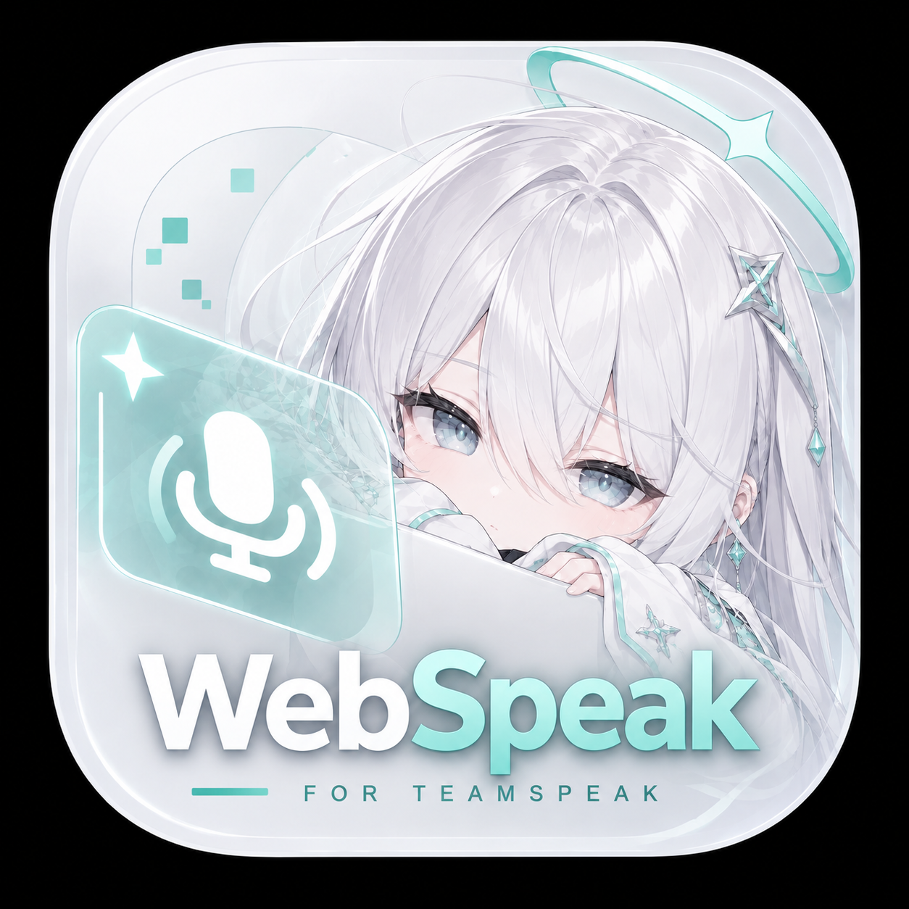
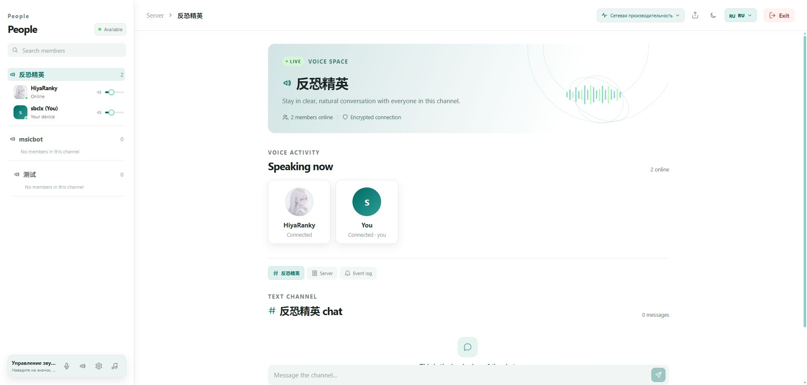
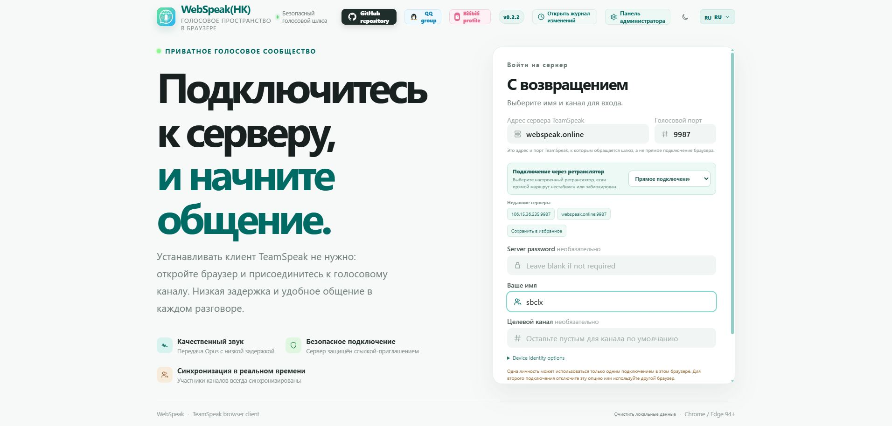
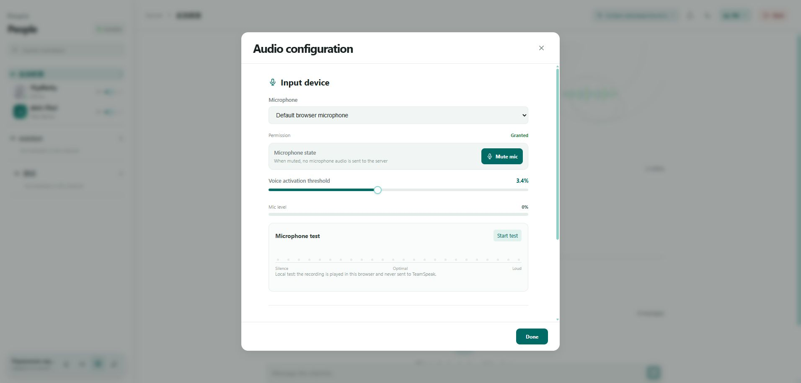
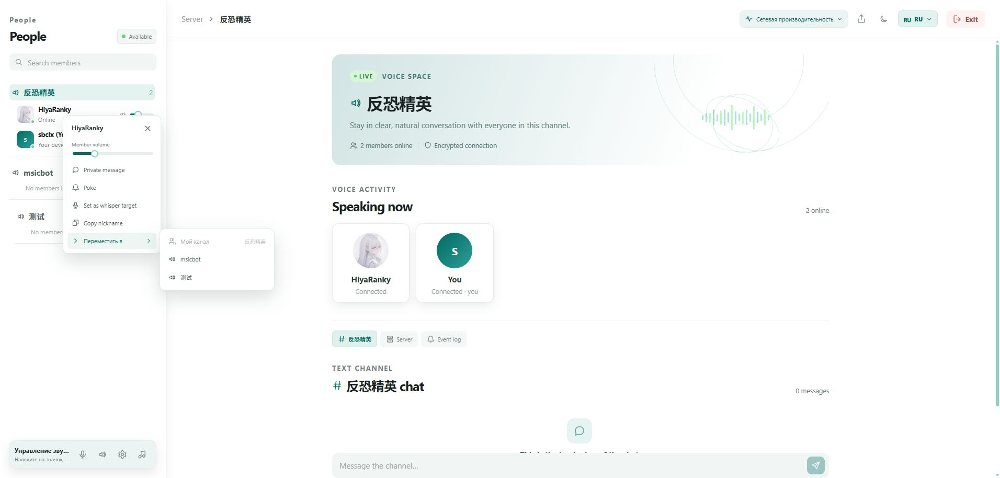

<a id="readme-top"></a>

<div align="center">
  
  <h1>WebSpeak · Русский</h1>
  <p><strong>Ваше сообщество TeamSpeak — прямо в браузере.</strong></p>
  <p><a href="../README.md">Главная проекта</a> · <a href="./README.zh-CN.md">简体中文</a> · <a href="./README.en.md">English</a> · <a href="./README.de.md">Deutsch</a> · <a href="./README.ja.md">日本語</a></p>
  <p>
    <a href="https://github.com/EchoSixHIYA/WebSpeak-client-for-TeamSpeak/releases/latest"></a>
    <a href="../LICENSE"></a>
  </p>
</div>

WebSpeak — самостоятельно размещаемый браузерный клиент и голосовой шлюз для TeamSpeak 3 и TeamSpeak 6. Пользователи подключаются к голосу, чату и демонстрации экрана через браузер, а оператор управляет серверами, доступом и данными в веб-консоли.

Стабильный выпуск: [изменения v0.2.9](#latest-release-notes) · [скачать пакеты](https://github.com/EchoSixHIYA/WebSpeak-client-for-TeamSpeak/releases/latest). Магазин функциональных плагинов пока доступен в `dev` и не входит в v0.2.9.

[Онлайн-демо](#demo) · [Возможности](#features) · [Скриншоты](#screenshots) · [Развёртывание](#deployment) · [Управление](#administration) · [Расширенные настройки](#advanced) · [Скины и плагины](#extensions) · [Решение проблем](#troubleshooting) · [История изменений](#changelog)

<a id="demo"></a>

## Онлайн-демо

- [Шанхай · shanghai.webspeak.online](https://shanghai.webspeak.online)
- [Гонконг · webspeak.online](https://webspeak.online)

Попробуйте главную страницу и голосовое пространство. Сеть, нагрузка и доступность демонстрационных узлов могут меняться.

<a id="features"></a>

## Возможности

| Возможность | Описание |
| --- | --- |
| Голос | Opus, необязательный WebRTC и резервный WebSocket; отключение микрофона, VOX, выбор устройств, шумоподавление в браузере и громкость участников. |
| Каналы и сообщения | Дерево и разделители каналов TeamSpeak, состояние участников, переходы, чат канала/сервера/личный чат, толчки, шёпот и локальная история. |
| Экран и аудио | Обмен экраном между браузерами и поддерживаемыми нативными клиентами TeamSpeak 6, настройки качества, битрейта и статистика; звук окна или вкладки на компьютере. |
| Идентичность и подключения | Сохранение идентичности, импорт/экспорт TS3, избранное и история, разрешение SRV и Nickname, IPv4/IPv6 и приглашения. |
| Управление экземпляром | Фиксированные или открытые цели, доступ, приглашения, сессии, журналы, диагностика, резервные копии и необязательное управление TeamSpeak. |
| Скины и интерфейс | Дневная, ночная, ILLUSIA и KAAK, пакеты `.wskin` через GitHub, пять языков и адаптивная вёрстка. |
| Распределённый голос | Браузер подключается напрямую к выбранному голосовому ретранслятору, сохраняя URL входного экземпляра. |
| Развёртывание | Docker amd64/arm64, серверные пакеты Windows x64 и Linux x64/ARM64, а также предварительные Android APK. |

### Совместимость версий TeamSpeak

Голосовые соединения используют стандартный клиентский протокол TeamSpeak и не требуют учётных данных Query. Необязательное управление TS использует отдельные данные WebQuery / ServerQuery.

- **TeamSpeak 3**: определение распознаёт ведущую версию `3.x`. Старые версии сервера следует проверять отдельно в конкретной среде: не каждая историческая версия тестировалась независимо.
- **TeamSpeak 6**: поддерживается, включая демонстрацию экрана с нативными клиентами TeamSpeak 6.
- **Автоопределение**: шлюз читает ответ сервера `version` и записывает распознанный протокол в диагностику подключения.
- Шлюз использует upstream SDK `1.0.0-beta.19` [`@honeybbq/teamspeak`](https://github.com/HoneyBBQ/teamspeak-js); WebSpeak рассчитан на TeamSpeak 3 и 6.

<a id="screenshots"></a>

## Скриншоты



<details>
<summary>Показать главную страницу, настройки аудио и меню участника</summary>

### Главная страница



### Настройки аудио



### Меню участника



</details>

<a id="deployment"></a>

## Развёртывание и первый запуск

Compose использует `network_mode: host` и рассчитан на Linux-хосты Docker. Для сервера Windows используйте пакет Release.

| Способ | Подходит для |
| --- | --- |
| Docker Compose | Постоянного сервера и простых обновлений |
| Пакет Release | Запуска без Node.js и инструментов сборки |
| Из исходников | Разработки и настройки проекта |

### Docker Compose

```bash
git clone --depth 1 https://github.com/EchoSixHIYA/WebSpeak-client-for-TeamSpeak.git
cd WebSpeak-client-for-TeamSpeak
docker compose pull
docker compose up -d
```

После запуска откройте `http://<ваш-хост>:3040/admin`, войдите с `admin` / `admin`, сразу смените пароль и настройте TeamSpeak. Данные хранятся в volume `webspeak-data`. Не используйте `docker compose down -v`, если не хотите удалить базу и настройки.

```bash
docker compose ps
docker compose logs -f webspeak
```

Обновление с сохранением данных:

```bash
git pull --ff-only
docker compose pull
docker compose up -d
```

### Пакет Release

Скачайте подходящий пакет `windows-x64.zip`, `linux-x64.tar.gz` или `linux-arm64.tar.gz` из [Releases](https://github.com/EchoSixHIYA/WebSpeak-client-for-TeamSpeak/releases/latest) и запустите приложенный скрипт. Docker поддерживает amd64/arm64. Также доступны Android APK для `arm64-v8a`, `armeabi-v7a` и `x86_64`; они подписаны отладочным ключом для ручной установки и тестирования, а не для Google Play. Голос TeamSpeak на реальных устройствах пока не проверен.

### Из исходников

```bash
git clone https://github.com/EchoSixHIYA/WebSpeak-client-for-TeamSpeak.git
cd WebSpeak-client-for-TeamSpeak
npm ci --ignore-scripts
npm rebuild @discordjs/opus --foreground-scripts
npm --prefix web ci
npm run web:build
npm run build
npm start
```

Для сборки нужны Node.js `>=22.12`, Python, Make и компилятор C/C++.

### Первый запуск

1. Откройте `http://<your-host>:3040/admin`.
2. Войдите с `admin` / `admin` и сразу задайте новый пароль длиной не менее 12 символов.
3. В разделе **Сервер** настройте цель, например `voice.example.com#9987`, и режим доступа.
4. Для публичного доступа настройте HTTPS; при включении WebRTC откройте весь указанный диапазон UDP.

### HTTPS и постоянные данные

Публичную страницу и WebSocket следует предоставлять по HTTPS. Например, направьте свой домен на хост и настройте Caddy как обратный прокси:

```caddyfile
webspeak.example.com {
  reverse_proxy 127.0.0.1:3040
}
```

Замените домен примера своим. Рабочий обратный прокси или Tunnel не гарантирует доступность UDP-медиа; см. [расширенные настройки](#advanced). Пакеты и исходники используют `data/`, Docker — volume `webspeak-data`. При переносе и резервном копировании сохраняйте вместе `webspeak.db` и соответствующий `master.key`.

<a id="administration"></a>

## Панель администратора

Откройте `/admin` для управления серверами, доступом, WebRTC, ретрансляторами, приглашениями, активными сессиями, журналами и резервными копиями. Магазин скинов: `/admin/skins`; магазин функциональных плагинов (dev): `/admin/plugins`.

### Необязательное управление TeamSpeak

Панель WebSpeak и голосовые соединения работают независимо от этой функции. В режиме фиксированного сервера откройте `/admin/ts-admin` для настройки управления TS.

1. Включите WebQuery на сервере TS и попросите уполномоченного администратора TS создать API-ключ. Укажите HTTP/HTTPS-адрес WebQuery и ключ. Это Query-служба TS, а не сайт WebSpeak. Поддерживаются TS3 начиная с 3.12 и TS6.
2. ID виртуального сервера `0` выбирает сервер по голосовому порту фиксированной цели. Для ограниченного ключа укажите разрешённый ID. Ключ чтения позволяет просматривать данные; изменения требуют области с правом записи и соответствующих прав TS.
3. Можно выбрать ServerQuery SSH или ServerQuery TCP для TS3. Укажите Query-хост (пустое поле использует фиксированную цель), порт, имя пользователя и пароль; SSH также требует доверенный отпечаток ключа хоста. Это не SSH-вход в операционную систему. TCP не шифруется и подходит только для доверенных сетей. HTTPS-сертификат должен быть доверенным для шлюза.
4. Сохраните и подключитесь или обновите данные. Доступны настройки сервера, управление каналами, перемещение/исключение/блокировка участников, назначение групп и снятие блокировок. Действия требуют подтверждения и проверяются TS; списки обновляются вручную.

Учётные данные хранятся на сервере в зашифрованном виде и не возвращаются API. Сохраняйте базу данных вместе с `master.key`. Ошибка управления не влияет на панель WebSpeak и голос. Блокировка по UID не затрагивает других пользователей с общим IP шлюза.

<a id="advanced"></a>

## Расширенные настройки

### WebRTC

Включается в **Панель администратора → Сервер → Расширенные настройки**. До включения задайте диапазон UDP-портов (по умолчанию `40000–40099`), откройте его в firewall и сохраните. При включённом WebRTC диапазон заблокирован; новые подключения используют WebRTC, а неподдерживаемые браузеры переходят на совместимый транспорт. Для публичного доступа нужен HTTPS.

### Голосовой WebRTC за обратным прокси или TCP Tunnel

В **Сервер → Расширенные настройки** задайте **публичный адрес медиа**: доступный по UDP IP или домен голосового шлюза без схемы, пути и порта. Он заменяет адрес, определяемый по запросу страницы. Домен прокси не обязательно доступен для медиатрафика.

**IPv6-кандидаты** включаются отдельно и сохраняют IPv4; необходимы маршрутизация IPv6 и правила firewall. В поле **голосовой STUN** можно указать `stun:turn.teamspeak.com:3478`: браузер и шлюз используют один сервис. Пустое поле сохраняет прежнее поведение: встроенный STUN библиотеки шлюза и отсутствие STUN в браузере. Поле принимает доступный по IPv4 UDP STUN с доменом или IPv4, но не IPv6-литералы и не учётные данные TURN.

Сохраните настройки и подключитесь заново. Откройте весь диапазон UDP и сохраняйте номера портов при статическом пробросе. STUN обнаруживает отображения адресов, но не ретранслирует звук. Один TCP Tunnel без доступного UDP/IPv6 не предотвращает переход на совместимый транспорт.

### ICE для демонстрации экрана

Медиа демонстрации экрана по-прежнему предпочитает прямое соединение между браузерами; WebSpeak только передаёт сигнальные сообщения. По умолчанию используются публичные STUN-серверы TeamSpeak для поиска внешних кандидатов, STUN не передаёт медиаданные. Авторизованный внешний TURN можно задать через `WEBSPEAK_SCREEN_SHARE_ICE_SERVERS` в виде JSON-массива, например:

```json
[{"urls":"stun:turn.teamspeak.com:3478"},{"urls":"turns:turn.example.com:5349","username":"<username>","credential":"<credential>"}]
```

При настроенном TURN медиа может идти через этот внешний сервис, но не через шлюз WebSpeak. Без TURN используются только прямые ICE-пути и STUN.

### Кроссплатформенная P2P-трансляция экрана

Пользователи браузера и нативные клиенты TeamSpeak 6 могут обнаруживать, запускать и смотреть трансляции друг друга. Между браузерами, а также между браузером и нативным клиентом, экран передаётся по прямому соединению WebRTC/ICE, когда это возможно; WebSpeak отвечает за авторизацию сессии, состояние трансляции и передачу SDP/ICE-сигналов, но не переносит медиаданные экрана. Интерфейс показывает статус трансляции и число зрителей и предоставляет регулировку громкости, полноэкранный режим и выход. Для захвата доступны настройки до 1080p и 60 FPS, а также статистика WebRTC.

### Ретрансляторы

Входной шлюз выдаёт подписанный одноразовый билет, после чего браузер подключается прямо к голосовому шлюзу ретранслятора, а тот — к TeamSpeak. URL страницы остаётся прежним. Узел не предоставляет главную страницу и панель администратора.

<details>
<summary>Запуск и настройка ретранслятора</summary>

```bash
docker run -d --name webspeak-relay --restart unless-stopped --network host \
  -e WEBSPEAK_MODE=relay \
  -e WEBSPEAK_RELAY_TOKEN='replace-with-a-long-random-token' \
  -e WEBSPEAK_RELAY_PORT='39087' \
  -e WEBSPEAK_RELAY_WEBRTC_PUBLIC_HOST='relay.example.com' \
  ghcr.io/echosixhiya/webspeak:latest
```

Используйте случайный общий токен длиной не менее 16 символов. Голосовой шлюз слушает `127.0.0.1:3041`; направьте на него HTTPS/WSS-домен через Caddy:

```caddyfile
relay.example.com {
  reverse_proxy 127.0.0.1:3041
}
```

В **Сервер → Ретрансляторы** входного экземпляра задайте имя, UDP-адрес `relay.example.com#39087`, голосовой адрес `https://relay.example.com` и тот же токен. После сохранения посетитель выбирает прямое подключение или узел. Откройте UDP `39087` и WebRTC `40000–40099`; публичный адрес медиа должен разрешаться непосредственно в доступный ретранслятор, а не в HTTP-прокси.

Для запуска из исходников или пакета задайте те же переменные. После сборки выполните `node dist/index.js`, а в пакете — `./runtime/node ./dist/index.js` (Windows: `.\runtime\node.exe .\dist\index.js`).

</details>

### Зависимости

Ретранслятор встроен в WebSpeak и использует стандартные библиотеки Node.js. WebRTC использует [werift](https://github.com/shinyoshiaki/werift-webrtc) `0.24.4`. TeamSpeak использует upstream [HoneyBBQ/teamspeak-js](https://github.com/HoneyBBQ/teamspeak-js), пакет `@honeybbq/teamspeak@1.0.0-beta.19`; сборка форка не нужна.

<a id="extensions"></a>

## Скины и функциональные плагины

### Пакеты скинов `.wskin`

Скины задают оформление, компоновку и связанные виджеты. Администратор устанавливает, включает и выбирает скин по умолчанию. Авторы используют публичный интерфейс без изменения исходников WebSpeak.

[Руководство](./SKIN_DEVELOPMENT.md) · [Agent Skill](../.agents/skills/webspeak-skin-development/SKILL.md) · [Каталог скинов](https://github.com/Huddle-Up-Forge/webspeak-skins) · [Пример Discord Voice](https://github.com/Huddle-Up-Forge/webspeak-skin-discord-voice)

### Функциональные плагины `.wplugin` (dev)

Функциональные плагины — самостоятельные приложения с API браузера, необязательными сервисами Node, своими маршрутами, данными и совместной работой. Администратор проверяет код и зависимости перед включением; обновления требуют повторного доверия. Приложения работают на отдельном источнике в области TS-сервера или экземпляра. API v2 требует текущую dev-версию и не входит в v0.2.9.

[Руководство](./PLUGIN_DEVELOPMENT.md) · [Agent Skill](../.agents/skills/webspeak-plugin-development/SKILL.md) · [Каталог распространения и пример](https://github.com/Huddle-Up-Forge/webspeak-plugin)

<a id="troubleshooting"></a>

## Решение проблем

| Проблема | Что проверить |
| --- | --- |
| WebRTC включён, но используется резервный транспорт | Код ошибки голосового статуса, HTTPS, весь диапазон UDP и публичный адрес медиа. TCP Tunnel не переносит этот UDP-трафик. |
| Цель заблокирована как локальный адрес | Открытый режим ограничивает loopback и частные адреса. Для TS на том же хосте используйте настроенный администратором режим фиксированного сервера. |
| Тайм-аут или чёрный экран трансляции | Экран использует отдельное WebRTC-соединение. Проверьте согласование, ICE и кодек в статистике трансляции; работающий голос не подтверждает доступность видео. |
| После обновления нет данных или они не расшифровываются | Используйте прежний каталог/volume и соответствующий `master.key`. Не обновляйте через `docker compose down -v`. |

### ⚠️ Требования и замечания

- Node.js `>=22.12` нужен для сборки из исходников; Docker и Release уже содержат необходимые компоненты.
- Нужен современный Chrome, Edge или другой браузер с WebRTC. Микрофон и звук окна обычно требуют HTTPS.
- WebSpeak должен иметь доступ к TeamSpeak; стандартный голосовой порт — `9987`.
- Веб-сервис использует `3040/TCP`; для публичного сайта направьте HTTPS и WebSocket через обратный прокси.
- Для IPv6 нужен маршрутизируемый IPv6, включённый IPv6 в ОС/контейнере и правила firewall. Литерал задаётся как `[2001:db8::1]#9987`.
- Одна сохранённая браузерная идентичность может использоваться только одним активным подключением.
- Фоновая музыка доступна только на компьютере и требует WebRTC.

- WebRTC использует UDP `40000–40099` по умолчанию; откройте весь диапазон. Для смены диапазона сначала выключите WebRTC и сохраните.
- Лимит приложения — 100 активных браузерных сессий на экземпляр; это не гарантия производительности и не лимит лицензии TS.

<a id="changelog"></a>

## История изменений

<a id="latest-release-notes"></a>

### [v0.2.9](https://github.com/EchoSixHIYA/WebSpeak-client-for-TeamSpeak/releases/tag/v0.2.9) · 2026-10-24

#### Новые возможности

- Переход на upstream SDK 1.0.0-beta.19. Обычные голосовые подключения используют актуальный каталог клиентов без разрешений Query на получение списков.
- Добавлен магазин скинов GitHub с установкой, обновлением и управлением доступностью для экземпляра. Discord Voice распространяется отдельно как стандартный пример `.wskin`.
- В режиме фиксированного сервера доступна необязательная панель TS: учётные данные WebQuery, TCP или SSH Query позволяют управлять сервером, каналами, участниками, серверными группами и блокировками.
- Ретрансляторы могут предоставлять браузеру прямую голосовую точку подключения и обслуживать голосовую сессию без лишнего перехода через основной шлюз.
- Добавлены общие интерфейсы сохранения рабочего пространства и переподключения; KAAK использует их и предлагает вход в администрирование, GitHub проекта и группу QQ.
- Поддержаны разделители каналов TeamSpeak: выравнивание, повторяемое заполнение, пустые строки и стандартные линии. Данные оформления доступны скинам.

#### Исправления

- Исправлены размер полноэкранного показа экрана и очистка состояния и ресурсов воспроизведения ушедших участников.
- Успешная блокировка больше не отображается как ошибка; Query-подключения исключены из числа участников, исправлена подпись пароля канала.
- Разделены ошибки разрешений, ограничения частоты и тайм-аута. Ошибка обновления после успешной операции показывается отдельно, чтобы избежать повторного выполнения.
- Добавлена защита от ошибочного распознавания SDK неуспешных HTTP-ответов как успешных результатов WebQuery; исправлена компоновка DC на главной странице, в чате и на узких экранах.

#### Известные проблемы

- Усиление безопасности из [PR #48](https://github.com/EchoSixHIYA/WebSpeak-client-for-TeamSpeak/pull/48) не вошло в выпуск; закрытие PR не означает исправления описанных проблем.

<details>
<summary>Показать v0.2.8 и более ранние версии</summary>

### [v0.2.8](https://github.com/EchoSixHIYA/WebSpeak-client-for-TeamSpeak/releases/tag/v0.2.8) · 2026-10-17

#### Демонстрация экрана и стабильность соединения

- Исправлены согласование соединения и обработка видеопотока при демонстрации экрана между браузерами и нативными клиентами TeamSpeak.
- Улучшена обработка быстрых переключений каналов, чтобы избежать несогласованного состояния клиента.
- Исправлено отображение содержимого некоторых компонентов скинов и локализации KAAK.

#### Улучшения интерфейса

- Названия аудиоустройств теперь отображаются полностью и переносятся при нехватке места, чтобы длинные названия было легче различать.
- Исправлено случайное выделение текста-заглушки аватара.

### [v0.2.7](https://github.com/EchoSixHIYA/WebSpeak-client-for-TeamSpeak/releases/tag/v0.2.7) · 2026-10-13

#### Более открытая система скинов

- Более открытый редактор и среда выполнения скинов позволяют настраивать стиль и расположение любых компонентов, а также добавлять виджеты.
- Откройте голосовую панель, затем в том же браузере откройте новое окно панели администратора и войдите в систему, чтобы активировать редактор скинов.
- Скин KAAK включён в комплект как пример для разработки.
- Обновлён Agent Skill по разработке скинов.

#### Улучшения функций

- Добавлено разрешение серверных адресов через записи SRV и записи TeamSpeak Nickname.
- В свободном режиме можно управлять вкладками нескольких серверов; эти кнопки недоступны в режиме фиксированного сервера.
- Добавлен выбор битрейта демонстрации экрана.
- WebSpeak теперь сохраняет введённые пароли каналов в браузере.
- Перед закрытыми паролем каналами отображается значок замка.
- История чата теперь хранится постоянно.

#### Исправления ошибок

- Исправлена ошибка разбора адресов.
- Устранён конфликт фокуса между регулировкой громкости и перетаскиванием карточек участников.
- Исправлена ошибочная классификация состояния пользователя как неизвестного.

### [v0.2.6](https://github.com/EchoSixHIYA/WebSpeak-client-for-TeamSpeak/releases/tag/v0.2.6) · 2026-10-08

Относительно 0.2.5 масштабно перестроены голосовой шлюз, общие протоколы, голосовая область и модули администратора; исправлены #6/#7/#10, реализованы #9/#12 и случай с обнаружением уже активной демонстрации TS6 из PR #13. Улучшены Opus, жизненные циклы сессий и мобильное управление. Пакеты: Windows x64, Linux x64/ARM64, Docker amd64/arm64, Android arm64-v8a/armeabi-v7a/x86_64.

### [v0.2.5](https://github.com/EchoSixHIYA/WebSpeak-client-for-TeamSpeak/releases/tag/v0.2.5) · 2026-09-27

Добавлены скины `.wskin`, управление включением и темой по умолчанию, а также защищённые темы «День», «Ночь» и ILLUSIA; удалён незавершённый пример Aurora Voice, исправлены мерцание при загрузке скина, контраст элементов в тёмном режиме и слои иллюстраций в голосовом пространстве; добавлен официальный Agent Skill для разработки скинов.

### [v0.2.4](https://github.com/EchoSixHIYA/WebSpeak-client-for-TeamSpeak/releases/tag/v0.2.4) · 2026-09-22

Добавлена кроссплатформенная P2P-трансляция экрана между браузерами и нативными клиентами TeamSpeak 6; добавлены настройка STUN/внешнего TURN, проигрыватель и состояние зрителей, захват до 1080p/60 FPS и статистика WebRTC; улучшено управление трансляцией и добавлен номер посетителя.

### [v0.2.3](https://github.com/EchoSixHIYA/WebSpeak-client-for-TeamSpeak/releases/tag/v0.2.3) · 2026-09-19

Добавлены управление перемещением участников и прямое перемещение с учётом прав; поддержаны аватары, синхронизация микрофона и восстановление идентичности; обновлены скриншоты и документация для пяти языков.

### [v0.2.2](https://github.com/EchoSixHIYA/WebSpeak-client-for-TeamSpeak/releases/tag/v0.2.2) · 2026-09-17

Добавлены браузерное шумоподавление микрофона, русский и японский интерфейсы и отдельные тексты приветствия; улучшены управление громкостью и сообщения/коды ошибок на основе PR #2.

### [v0.2.1](https://github.com/EchoSixHIYA/WebSpeak-client-for-TeamSpeak/releases/tag/v0.2.1) · 2026-09-13

Улучшены ошибки на странице входа и добавлена поддержка IPv6-целей по умолчанию.

### [v0.2.0](https://github.com/EchoSixHIYA/WebSpeak-client-for-TeamSpeak/releases/tag/v0.2.0) · 2026-09-10

Добавлены подсказки пароля, режим ретранслятора, выбор нескольких узлов и диагностика подключений.

### [v0.1.8](https://github.com/EchoSixHIYA/WebSpeak-client-for-TeamSpeak/releases/tag/v0.1.8) · 2026-09-08

Упрощён Docker-запуск, добавлен тайм-аут подключения 15 секунд и непрерывный сетевой мониторинг.

### [v0.1.7](https://github.com/EchoSixHIYA/WebSpeak-client-for-TeamSpeak/releases/tag/v0.1.7) · 2026-09-06

Добавлены немецкий язык, Telegram, панель сетевой статистики и общая громкость; исправлены колебания громкости фоновой музыки.

### [v0.1.6](https://github.com/EchoSixHIYA/WebSpeak-client-for-TeamSpeak/releases/tag/v0.1.6) · 2026-09-04

Добавлены передача звука окна/вкладки, напоминание о сохранении идентичности и значок сайта; исправлена индивидуальная громкость в WebRTC.

### [v0.1.5](https://github.com/EchoSixHIYA/WebSpeak-client-for-TeamSpeak/releases/tag/v0.1.5) · 2026-09-04

Исправлено сохранение идентичности и улучшено переключение тем.

### [v0.1.4](https://github.com/EchoSixHIYA/WebSpeak-client-for-TeamSpeak/releases/tag/v0.1.4) · 2026-09-03

Исправлены WebRTC и чат канала, улучшены панель управления, журналы и мобильная компоновка.

### [v0.1.3](https://github.com/EchoSixHIYA/WebSpeak-client-for-TeamSpeak/releases/tag/v0.1.3) · 2026-09-03

Добавлен встроенный WebRTC, заменён TeamSpeak SDK, улучшены синхронизация участников и буферизация голоса.

</details>

<a id="contributors"></a>

## Участники и вклад в проект

<details>
<summary>Показать авторов SDK и вклад через PR</summary>

Список отмечает автора SDK, используемого в основе проекта, вклад через объединённые PR на GitHub и исходные работы, перенесённые в отдельно распространяемые пакеты скинов.

- [HoneyBBQ](https://github.com/HoneyBBQ) — Автор SDK [teamspeak-js (`@honeybbq/teamspeak`)](https://github.com/HoneyBBQ/teamspeak-js), который предоставляет используемый WebSpeak клиент протокола TeamSpeak.
- [LainHE](https://github.com/LainHE) — [объединённые PR #2, #8, #28, #31–#35, #37, #38 и #40](https://github.com/EchoSixHIYA/WebSpeak-client-for-TeamSpeak/pulls?q=is%3Apr+is%3Amerged+author%3ALainHE): переводы ошибок браузера, масштабирование и компоновка главной страницы, битрейт трансляции и аватары зрителей, проверка целей и восстановление ретранслятора, доверенные прокси, передача ошибок подключения, сообщения об ошибках аудио и освобождение ресурсов при сбоях WebRTC.
- [TimmySheep](https://github.com/TimmySheep) — [объединённые PR #13 и #15–#24](https://github.com/EchoSixHIYA/WebSpeak-client-for-TeamSpeak/pulls?q=is%3Apr+is%3Amerged+author%3ATimmySheep): обнаружение активных трансляций TS6, пропорции экрана, мобильное аудио/подсветка экрана/меню скинов, канал в настройках идентичности, PWA/темы, история чата, состояние аудио участников и разрешение микрофона.
- [yichen11818](https://github.com/yichen11818) — [PR #25](https://github.com/EchoSixHIYA/WebSpeak-client-for-TeamSpeak/pull/25) добавил подключение по зарегистрированным именам TeamSpeak с сохранением имени цели; [PR #51](https://github.com/EchoSixHIYA/WebSpeak-client-for-TeamSpeak/pull/51) улучшил сохранение рабочего пространства KAAK и повторное подключение после первого соединения. [PR #27](https://github.com/EchoSixHIYA/WebSpeak-client-for-TeamSpeak/pull/27) и [PR #52](https://github.com/EchoSixHIYA/WebSpeak-client-for-TeamSpeak/pull/52) содержали исходный дизайн и реализацию скина Discord (автор коммитов **yumi**), которые проект WebSpeak перенёс в [отдельно распространяемый скин `.wskin`](https://github.com/Huddle-Up-Forge/webspeak-skin-discord-voice).

</details>

## Сообщество и проекты

[GitHub Issues](https://github.com/EchoSixHIYA/WebSpeak-client-for-TeamSpeak/issues) · [QQ-группа 869500475](http://qm.qq.com/cgi-bin/qm/qr?_wv=1027&k=yhumUMDD9PmyYFWdXWUb_x7hM5trFQY8&authKey=Pw3HBGT7GwMinTQnuFGfnpf0aRSzXOJKcAiujVP1%2BXMpjheAKrncTRivicBJxpjV&noverify=0&group_code=869500475) · [Telegram](https://t.me/+8qShpTcuN9A3MWY9)

[NeteaseTSBot](https://github.com/yichen11818/NeteaseTSBot) — музыкальный бот TeamSpeak с поддержкой разных платформ и веб-консолью.

## Лицензия

WebSpeak распространяется по [AGPL-3.0-only](../LICENSE). Лицензии и авторство сторонних зависимостей указаны в соответствующих проектах.

<p align="right"><a href="#readme-top">Наверх ↑</a></p>
