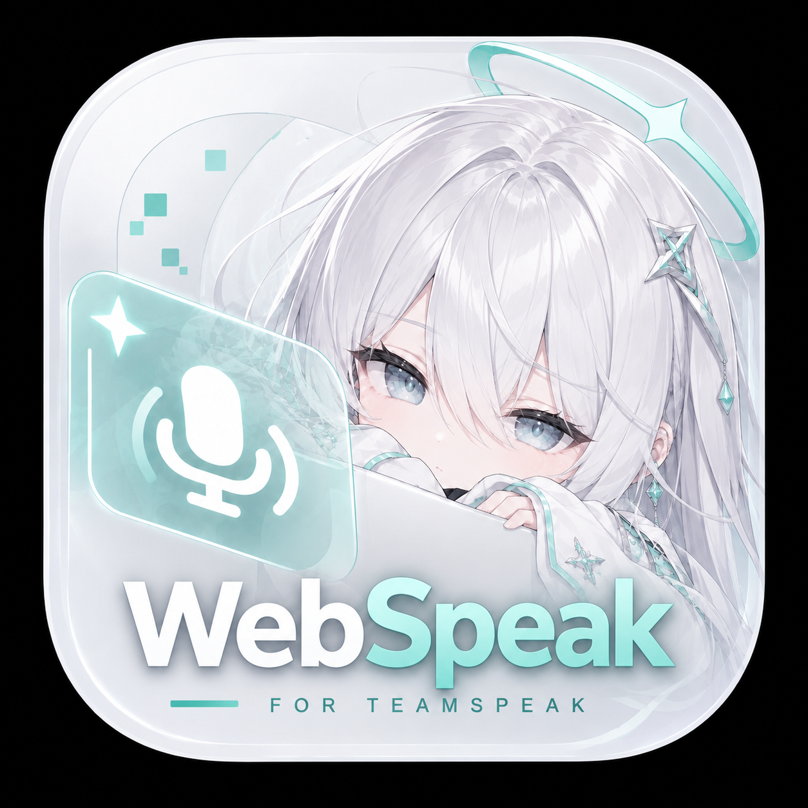
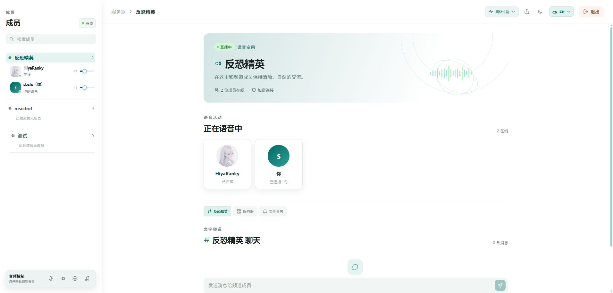
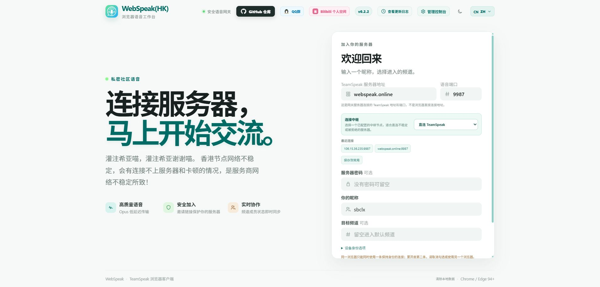
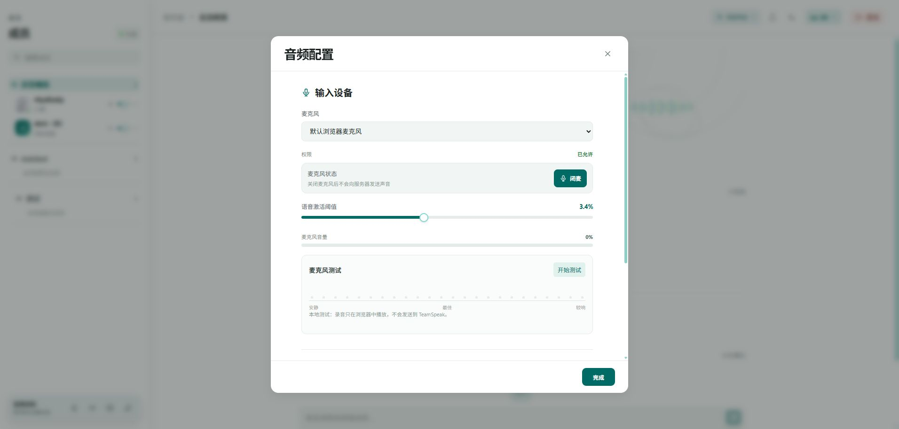
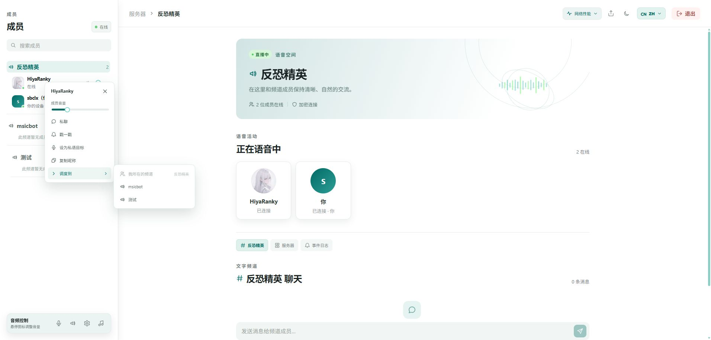

<a id="readme-top"></a>

<div align="center">
  
  <h1>WebSpeak · 简体中文</h1>
  <p><strong>打开浏览器，就能加入你的 TeamSpeak。</strong></p>
  <p><a href="../README.md">项目首页</a> · <a href="./README.en.md">English</a> · <a href="./README.de.md">Deutsch</a> · <a href="./README.ru.md">Русский</a> · <a href="./README.ja.md">日本語</a></p>
  <p>
    <a href="https://github.com/EchoSixHIYA/WebSpeak-client-for-TeamSpeak/releases/latest"></a>
    <a href="../LICENSE"></a>
  </p>
</div>

WebSpeak 是可自行部署的 TeamSpeak 3 / TeamSpeak 6 网页客户端与语音网关。用户通过浏览器加入语音、聊天和屏幕共享；部署者通过管理员控制台管理目标服务器、访问策略和数据。

稳定版：[v0.2.9 更新日志](#latest-release-notes) · [下载发布包](https://github.com/EchoSixHIYA/WebSpeak-client-for-TeamSpeak/releases/latest)。功能插件商店目前仅在 `dev` 分支提供，尚未包含在 v0.2.9 中。

开发分支安全修复：`dev` 已重新实现 PR #48 报告的 IPv6 目标校验、并发登录、改密会话撤销、可信代理限流与 PCM 上行保护。以下 v0.2.9 历史记录描述的是原发布包，不包含这次尚未发布的修复。

[在线演示](#demo) · [功能](#features) · [界面预览](#screenshots) · [部署](#deployment) · [管理](#administration) · [高级配置](#advanced) · [皮肤与插件](#extensions) · [常见问题](#troubleshooting) · [更新日志](#changelog)

<a id="demo"></a>

## 在线演示

- [上海 · shanghai.webspeak.online](https://shanghai.webspeak.online)
- [香港 · webspeak.online](https://webspeak.online)

可直接体验欢迎页与语音工作区。演示节点的网络、负载和可用性会变化。

<a id="features"></a>

## 主要功能

| 能力 | 说明 |
| --- | --- |
| 实时语音 | Opus 音频、可选 WebRTC、兼容 WebSocket 回退；支持闭麦、VOX、设备选择、浏览器降噪和成员独立音量。 |
| 频道与消息 | 频道树、TeamSpeak 频道分隔栏、成员状态、频道切换、频道/服务器/私聊消息、戳一戳、耳语及本地聊天历史。 |
| 屏幕与音频共享 | 浏览器之间及与受支持的 TeamSpeak 6 原生客户端共享屏幕；提供采集质量、码率和统计面板，桌面端还可分享窗口或标签页音频。 |
| 身份与连接 | 身份保持、TS3 身份导入/导出、收藏和历史连接、SRV 与 Nickname 地址解析、IPv4/IPv6 及邀请链接。 |
| 实例管理 | 固定或公开目标、访问策略、邀请、会话、日志、诊断、备份及可选的 TeamSpeak 管理连接。 |
| 皮肤与界面 | 日间、夜间、ILLUSIA 和 KAAK；可通过 GitHub 皮肤商店管理 `.wskin` 包，支持五种语言和响应式布局。 |
| 分布式语音 | 配置中继后，浏览器直接连接所选中继的语音网关，网页地址仍保留在入口实例。 |
| 部署方式 | Docker amd64/arm64、Windows x64 与 Linux x64/ARM64 发布包；另有 Android 预览 APK。 |

### TeamSpeak 版本兼容性

语音连接使用标准 TeamSpeak 客户端协议，无需 Query 凭据。可选的 TS 管理功能使用独立的 WebQuery / ServerQuery 凭据。

- **TeamSpeak 3**：协议识别会读取版本号开头的 `3.x`。并非所有历史服务器版本都经过独立验证，部署旧版本时请针对实际服务器进行测试。
- **TeamSpeak 6**：支持，也支持与 TeamSpeak 6 原生客户端进行屏幕共享。
- **自动探测**：网关读取服务器的 `version` 响应并在连接诊断中记录识别到的协议。
- 网关使用上游 [`@honeybbq/teamspeak`](https://github.com/HoneyBBQ/teamspeak-js) `1.0.0-beta.19` SDK；WebSpeak 面向 TeamSpeak 3 和 TeamSpeak 6。

<a id="screenshots"></a>

## 界面预览



<details>
<summary>展开欢迎页、音频设置与成员菜单</summary>

### 欢迎页



### 音频设置



### 成员菜单



</details>

<a id="deployment"></a>

## 部署与首次配置

以下 Compose 配置使用 `network_mode: host`，适用于 Linux Docker 主机。Windows 服务端可使用发布包。

| 方案 | 适用场景 | 环境 |
| --- | --- | --- |
| Docker Compose（推荐） | 长期运行、升级简单、数据持久化 | Docker Engine + Docker Compose |
| 发布包 | 不安装 Node.js 和构建依赖 | Windows x64 或 Linux x64/ARM64 |
| 源码运行 | 开发、调试和二次开发 | Node.js 22.12+、Git 和本地编译工具 |

### Docker Compose（推荐）

```bash
git clone --depth 1 https://github.com/EchoSixHIYA/WebSpeak-client-for-TeamSpeak.git
cd WebSpeak-client-for-TeamSpeak
docker compose pull
docker compose up -d
```

启动后访问 `http://<你的主机>:3040`。使用反向代理时将上游指向该地址；启用 WebRTC 时放行控制台显示的 UDP 端口范围。数据保存在 `webspeak-data` volume 中。

```bash
docker compose ps
docker compose logs -f webspeak
```

升级：

```bash
git pull --ff-only
docker compose pull
docker compose up -d
```

不要执行 `docker compose down -v`，否则会删除数据库和管理员设置。

### 发布包

从 [GitHub Releases](https://github.com/EchoSixHIYA/WebSpeak-client-for-TeamSpeak/releases/latest) 下载与系统和架构匹配的 `windows-x64.zip`、`linux-x64.tar.gz` 或 `linux-arm64.tar.gz`，解压后运行对应启动脚本。发布包自带 Node.js 运行时和生产依赖。Docker 镜像支持 amd64/arm64。

Release 同时提供 Android `arm64-v8a`、`armeabi-v7a` 和 `x86_64` APK。它们使用 debug 签名，可手动侧载测试；不是 Google Play 发布包，Android 真机语音仍需验收。

### 源码运行

```bash
git clone https://github.com/EchoSixHIYA/WebSpeak-client-for-TeamSpeak.git
cd WebSpeak-client-for-TeamSpeak
npm ci --ignore-scripts
npm rebuild @discordjs/opus --foreground-scripts
npm --prefix web ci
npm --prefix web run build
npm run build
npm start
```

构建 `@discordjs/opus` 需要 Python、Make 和 C/C++ 编译工具。

### 首次配置

1. 打开 `http://<你的主机>:3040/admin`。
2. 使用默认账号 `admin` / `admin` 登录，并立即设置至少 12 位的新密码。
3. 在“服务器”页配置 TeamSpeak 目标和访问方式，例如 `voice.example.com#9987`。
4. 公网使用时配置 HTTPS；启用 WebRTC 时放行控制台显示的 UDP 范围。

### HTTPS 与持久化

公网部署应通过 HTTPS 提供网页和 WebSocket。例如，将已解析到主机的域名配置到 Caddy，反向代理到 WebSpeak：

```caddyfile
webspeak.example.com {
  reverse_proxy 127.0.0.1:3040
}
```

以上域名仅为配置示例，请替换成自己的域名。网页能通过反向代理或 Tunnel 打开，并不表示 WebRTC 的 UDP 媒体可达；相关配置见[高级配置](#advanced)。发布包和源码的数据默认位于 `data/`，Docker 位于 `webspeak-data` volume；备份和迁移时同时保留 `webspeak.db` 与 `master.key`。

<a id="administration"></a>

## 管理员控制台

实例配置位于 `/admin`：管理服务器与访问策略、WebRTC 与中继、邀请、活动会话、运行日志和备份。皮肤商店位于 `/admin/skins`；功能插件商店（dev）位于 `/admin/plugins`。

### 可选的 TeamSpeak 管理

WebSpeak 后台和访客语音不依赖此功能。在固定服务器模式下，打开 `/admin/ts-admin`，可集中配置 TS 管理连接。

1. 在 TS 服务端启用 WebQuery，并由有权限的 TS 管理员创建 API Key。填写 WebQuery 的 HTTP/HTTPS 地址和 API Key；地址指向 TS Query 服务，而非 WebSpeak 网页。支持 TS3（3.12+）和 TS6。
2. 虚拟服务器 ID 填 `0` 时，按固定目标的语音端口选择；受限 Key 应填写其被授权的服务器 ID。只读 Key 可查看，修改需要可写作用域及相应的 TS 权限。
3. 也可选择 ServerQuery SSH 或 TS3 ServerQuery TCP，填写 Query 主机（留空沿用固定目标）、Query 端口、用户名和密码；SSH 还需要可信的主机密钥指纹。这是 TS 的 Query 服务，并非服务器操作系统的 SSH。TCP 不加密，仅适合可信网络；HTTPS 证书须受网关信任。
4. 保存后连接或刷新，可查看服务器、频道、成员、服务器组和封禁，执行服务器设置、频道创建/重命名/删除、成员移动/移出/身份封禁、服务器组分配和解封。操作需确认，由 TS 核验权限；列表手动刷新。

凭据仅加密保存在服务端，接口不返回密码或 API Key；备份时同时保留数据库和 `master.key`。管理连接失败不影响 WebSpeak 后台和普通语音。封禁按 UID 创建，避免误封共用网关 IP 的其他用户。

<a id="advanced"></a>

## 高级配置

高级功能均为可选项；关闭时仍可使用兼容语音传输。配置入口在管理员控制台的“服务器”页，保存后对新连接生效。

### WebRTC 低延迟语音

WebRTC 将浏览器语音切换到实时媒体通道，也支持桌面端伴奏。媒体服务由当前 WebSpeak 网关直接提供，不需要另设媒体服务器。

1. 登录 `/admin`，打开“服务器”页的“高级参数”。
2. 关闭 WebRTC 时设置 UDP 起止端口，默认范围为 `40000–40099`。
3. 在 WebSpeak 主机的安全组和防火墙中放行整个 UDP 范围。
4. 勾选“启用 WebRTC”并保存，用户重新进入后即可协商；不支持时会回退到兼容传输。

WebRTC 启用后端口范围会锁定。要修改端口，先关闭 WebRTC 并保存，再修改端口并同步防火墙规则。公网使用还需要 HTTPS。

### 反向代理 / TCP 隧道下的语音 WebRTC

在管理后台的 WebRTC 高级参数中可设置：

- **公网媒体地址**：WebSpeak 网关可被 UDP 访问的 IP 或域名，不含协议、路径或端口。优先于网页入口推断；留空时按 `Origin`、`X-Forwarded-Host`、`Host` 推断。域名会解析为 IP 候选。反代域名不一定是媒体地址。
- **启用 IPv6 候选**：默认关闭；开启后保留 IPv4，同时收集 IPv6。需确保 IPv6 路由及 UDP 防火墙放行。
- **语音 STUN 服务**：可设置 `stun:turn.teamspeak.com:3478`，浏览器和网关使用同一服务发现公网映射。留空保留旧行为：werift 网关仍使用库内置 STUN，浏览器不配置 STUN。当前字段仅支持可通过 IPv4 访问的 UDP STUN 域名或 IPv4 地址，不接受 IPv6 字面量、TURN 或凭据；IPv6 媒体候选独立于 STUN 开关。

保存后重新连接。网页和 WebSocket 经反代可达，不代表媒体 UDP 可达；STUN 仅发现地址，不中继音频，也不保证穿透所有 NAT。只有 TCP 隧道而无可用 UDP/IPv6 路径时，仍会回退兼容传输。应开放配置的整个 UDP 端口范围；静态端口转发需保持相同端口映射。

### 屏幕共享的 ICE 候选

屏幕共享媒体仍优先走浏览器之间的直连，WebSpeak 只转发协商信令。默认使用 TeamSpeak 官方 STUN 服务发现公网候选地址；STUN 不承载媒体。若部署者有合规的外部 TURN 服务，可在启动 WebSpeak 前设置 `WEBSPEAK_SCREEN_SHARE_ICE_SERVERS`，值为 JSON 数组，例如：

```json
[{"urls":"stun:turn.teamspeak.com:3478"},{"urls":"turns:turn.example.com:5349","username":"<username>","credential":"<credential>"}]
```

配置 TURN 后，媒体可能经过该外部 TURN 服务，但不会经过 WebSpeak 网关；未配置时只使用直连和 STUN。

### 跨端 P2P 屏幕共享

浏览器用户与 TeamSpeak 6 原生客户端可以互相发现、发起和观看屏幕共享。浏览器之间以及浏览器与原生客户端之间的屏幕媒体优先通过 WebRTC/ICE 端到端传输；WebSpeak 负责会话鉴权、共享状态和 SDP/ICE 信令转发，不承载屏幕媒体流量。页面提供直播状态、观众人数、播放器音量、全屏和退出控制，也可在共享设置窗口中选择最高 1080p 与 60 FPS，并查看 WebRTC 统计。

### 中继模式

中继适用于 TeamSpeak 拒绝境外连接或直连不稳定的情况。它不是 VPN，只转发当前 WebSpeak 会话的 TeamSpeak 数据；目标服务器仍由用户在网页中选择。

中继实例同时运行 UDP 兼容转发和独立语音网关，不提供访客首页或管理员后台。网关收到用户的入场请求后，会用共享令牌签名并转交一次性语音票据；浏览器随后直接连接中继节点，语音网关再从中继节点连接 TeamSpeak。网页地址仍保持在入口网关，不需要跳转。令牌至少使用 16 个字符的随机值。

<details>
<summary>展开中继启动与配置示例</summary>

#### 源码启动

```bash
git clone --depth 1 https://github.com/EchoSixHIYA/WebSpeak-client-for-TeamSpeak.git
cd WebSpeak-client-for-TeamSpeak
npm ci --ignore-scripts
npm rebuild @discordjs/opus --foreground-scripts
npm run build
WEBSPEAK_MODE=relay \
WEBSPEAK_RELAY_TOKEN='replace-with-a-long-random-token' \
WEBSPEAK_RELAY_HOST='0.0.0.0' \
WEBSPEAK_RELAY_PORT='39087' \
node dist/index.js
```

Windows PowerShell：

```powershell
$env:WEBSPEAK_MODE = "relay"
$env:WEBSPEAK_RELAY_TOKEN = "replace-with-a-long-random-token"
$env:WEBSPEAK_RELAY_HOST = "0.0.0.0"
$env:WEBSPEAK_RELAY_PORT = "39087"
node .\dist\index.js
```

#### 发布包启动

从 [Releases](https://github.com/EchoSixHIYA/WebSpeak-client-for-TeamSpeak/releases/latest) 下载并解压对应平台的包：

```bash
# Linux
export WEBSPEAK_MODE=relay
export WEBSPEAK_RELAY_TOKEN='replace-with-a-long-random-token'
export WEBSPEAK_RELAY_HOST='0.0.0.0'
export WEBSPEAK_RELAY_PORT='39087'
./runtime/node ./dist/index.js
```

Windows PowerShell 使用同名环境变量后运行 `.\runtime\node.exe .\dist\index.js`。

#### Docker 启动

```bash
docker run -d --name webspeak-relay --restart unless-stopped --network host \
  -e WEBSPEAK_MODE=relay \
  -e WEBSPEAK_RELAY_TOKEN='replace-with-a-long-random-token' \
  -e WEBSPEAK_RELAY_PORT='39087' \
  ghcr.io/echosixhiya/webspeak:latest
```

放行中继主机的 UDP 监听端口，默认是 `39087`。

语音网关默认监听 `127.0.0.1:3041`。为中继节点配置 HTTPS 域名，并让 Caddy 等反向代理把该域名转发到 `127.0.0.1:3041`，例如：

```caddyfile
relay.example.com {
  reverse_proxy 127.0.0.1:3041
}
```

管理员后台的中继节点设置中，将“语音网关地址”填写为该 HTTPS 源站（例如 `https://relay.example.com`）。网页仍从原入口网关加载，之后会通过 WSS 连接这个中继域名。语音网关默认启用 WebRTC；还需放行 UDP `40000-40099`，并设置 `WEBSPEAK_RELAY_WEBRTC_PUBLIC_HOST` 为可从用户网络直接访问的中继公网 IP 或直连域名。若修改了 WebRTC UDP 范围，同时更新防火墙规则。UDP `39087` 保留给旧版兼容转发。

#### 在网关中启用

1. 管理员控制台 → “服务器” → “中继服务器”，添加一个或多个节点。
2. 为每个节点填写自定义名称、UDP 地址（例如 `relay.example.com#39087`）、HTTPS 语音网关源站（例如 `https://relay.example.com`）和匹配令牌并保存。
3. 访客欢迎页即可选择直连或其中一个中继。

关闭并保存中继配置后，访客页面不会显示中继选项。

</details>

### 依赖与归属

- 中继服务是 WebSpeak 自带实现，使用 Node.js 标准库，不依赖 GOST、sing-box 或其他代理框架。
- WebRTC 使用 [werift](https://github.com/shinyoshiaki/werift-webrtc) `0.24.4`，上游采用 MIT 许可证。
- TeamSpeak 协议使用上游 [HoneyBBQ/teamspeak-js](https://github.com/HoneyBBQ/teamspeak-js) 发布的 `@honeybbq/teamspeak@1.0.0-beta.19`，无需构建项目 SDK fork。

<a id="extensions"></a>

## 皮肤与功能插件

### 皮肤包 `.wskin`

皮肤包负责外观、布局及其附属小组件。管理员可安装、启用和设置默认皮肤；开发时遵循公开接口，无需修改 WebSpeak 源码。

[开发指南](./SKIN_DEVELOPMENT.md) · [Agent Skill](../.agents/skills/webspeak-skin-development/SKILL.md) · [皮肤索引仓库](https://github.com/Huddle-Up-Forge/webspeak-skins) · [Discord Voice 示例](https://github.com/Huddle-Up-Forge/webspeak-skin-discord-voice)

### 功能插件 `.wplugin`（dev）

功能插件在独立面板中运行，与皮肤包分开。管理员可配置服务器作用域（同一 TS 目标与频道）或实例作用域（同一语音网关）；“一起观看”示例验证播放、暂停、跳转和中途加入的同步。需要当前 dev 运行时，不属于 v0.2.9。

[开发指南](./PLUGIN_DEVELOPMENT.md) · [Agent Skill](../.agents/skills/webspeak-plugin-development/SKILL.md) · [分发索引与示例](https://github.com/Huddle-Up-Forge/webspeak-plugin)

<a id="troubleshooting"></a>

## 常见问题

| 现象 | 检查方向 |
| --- | --- |
| WebRTC 启用后仍回退 | 检查语音状态中的错误代码、HTTPS、整段 UDP 防火墙规则和公网媒体地址。TCP Tunnel 不能转发这条 UDP 媒体路径。 |
| 连接目标被本地地址保护拦截 | 公开模式限制回环和私网目标。连接同机 TS 时使用管理员配置的固定服务器模式；面向访客的目标应填实际可访问的地址。 |
| 屏幕共享超时或黑屏 | 屏幕共享使用独立的 WebRTC 连接；检查共享统计中的协商、ICE 和编码信息。语音 WebRTC 已连接不代表屏幕媒体可达。 |
| 升级后数据丢失或无法解密 | 复用原数据目录或 volume，并保留匹配的 `master.key`；不要用 `docker compose down -v` 升级。 |

### ⚠️ 要求和注意事项

| 项目 | 要求或注意事项 |
| --- | --- |
| 浏览器 | 建议使用最新版 Chrome、Edge 或其他支持 WebRTC 的现代浏览器。麦克风和窗口音频通常要求 HTTPS。 |
| TeamSpeak 网络 | WebSpeak 主机必须能够访问目标 TeamSpeak；默认语音端口为 `9987`。 |
| Web 服务网络 | 服务使用 `3040/TCP`，公网建议通过 HTTPS 反向代理提供网页和 WebSocket。 |
| IPv6 | IPv6 字面量写为 `[2001:db8::1]#9987`。主机/容器需要可路由 IPv6、启用 IPv6 的操作系统和 Node.js，以及相应防火墙放行。 |
| WebRTC | 默认使用 `40000–40099/UDP`，启用后需放行整个范围；修改范围前先关闭 WebRTC。 |
| 身份保持 | 同一浏览器身份同时只能保持一条活动连接；并行连接请关闭第二条的身份保持或使用其他浏览器配置文件。 |
| 伴奏 | 仅桌面端提供且要求 WebRTC；选择窗口或标签页时还要勾选共享音频。 |
| 数据 | Docker 数据在 `webspeak-data` volume；发布包和源码运行数据在 `data/`。升级前建议备份。 |
| 会话上限 | 单实例最多允许 100 个活动网页会话；这是应用准入上限，不是性能保证或 TS 许可证额度。 |

<a id="changelog"></a>

## 更新日志

<a id="latest-release-notes"></a>

### [v0.2.9](https://github.com/EchoSixHIYA/WebSpeak-client-for-TeamSpeak/releases/tag/v0.2.9) · 2026-10-24

#### 功能增强

- 接入上游 SDK 1.0.0-beta.19，普通语音连接使用客户端实时目录，不再依赖 Query 列表权限。
- 管理员控制台新增 GitHub 皮肤商店，以及按实例管理、更新和启停皮肤的入口；Discord Voice 作为标准 `.wskin` 示例独立分发。
- 指定实例模式支持可选 TS 管理面板，可配置 WebQuery、TCP 或 SSH Query 凭据，管理服务器、频道、成员、服务器组和封禁。
- 中继可配置浏览器直连的语音入口，将语音会话交给中继节点处理，减少网关间的额外转发。
- 提供通用工作区保留与重连接口，KAAK 同步接入，并新增管理员、项目 GitHub 和 QQ 群入口。
- 支持 TeamSpeak 频道分隔栏，包括左中右对齐、重复填充、空白及标准线型；向皮肤开放格式化数据。

#### 问题修复

- 修复屏幕共享播放器的全屏尺寸，以及断线成员的状态、播放资源清理。
- 修复 TS 管理中封禁成功却报错、Query 连接混入成员统计和频道密码标签错误的问题。
- 区分权限、限流和超时提示；操作完成后的刷新失败单独提示，避免用户重复执行操作。
- 防止 SDK 将 HTTP 失败响应误判为 WebQuery 成功；修复 DC 首页、聊天区与窄屏控件布局。

#### 已知问题

- [PR #48](https://github.com/EchoSixHIYA/WebSpeak-client-for-TeamSpeak/pull/48) 记录的安全加固尚未纳入本版本，关闭该 PR 不代表相关问题已修复。

<details>
<summary>展开 v0.2.8 及更早版本</summary>

### [v0.2.8](https://github.com/EchoSixHIYA/WebSpeak-client-for-TeamSpeak/releases/tag/v0.2.8) · 2026-10-17

#### 屏幕共享与连接稳定性

- 修复网页与 TeamSpeak 原生客户端之间屏幕共享的协商和视频轨道处理问题。
- 改善快速切换频道时的队列处理，减少客户端状态错乱。
- 修复部分皮肤组件内容和 KAAK 皮肤多语言显示问题。

#### 界面改进

- 音频设备名称会完整显示；空间不足时自动换行，便于区分名称较长的设备。
- 修复头像占位文字被意外选中的问题。

### [v0.2.7](https://github.com/EchoSixHIYA/WebSpeak-client-for-TeamSpeak/releases/tag/v0.2.7) · 2026-10-13

#### 更开放的皮肤系统

- 现在提供更开放的皮肤编辑系统与运行支持，可以自定义任意组件的样式与位置并可添加小组件。
- 进入语音面板后，在同一个浏览器中新开并登录一个管理员后台窗口即可激活皮肤编辑器。
- 随包提供一款“KAAK”皮肤作为开发示例。
- 更新了皮肤开发 Agent Skill。

#### 功能增强

- 现在支持 SRV 和 Nickname 形式的服务器地址解析。
- 自由模式下，允许用户进行多服务器标签管理（这些按钮在“固定服务器”的模式下不可用）。
- 屏幕共享新增码率选项。
- 现在 WebSpeak 会将输入过的频道密码保存到浏览器中。
- 现在会在上锁的频道前显示带锁的图标。
- 现在聊天记录能够持久化存储了。

#### Bug 修复列表

- 修复了解析 bug。
- 修复了音量和卡片拖动争抢焦点的问题。
- 修复了用户状态被错误地解析为未知的问题。

### [v0.2.6](https://github.com/EchoSixHIYA/WebSpeak-client-for-TeamSpeak/releases/tag/v0.2.6) · 2026-10-08

相对 0.2.5 大范围重构语音网关、共享协议、前端语音工作区与管理模块；修复 #6/#7/#10，完成 #9/#12 配置，并修复 PR #13 报告的既有 TS6 屏幕共享漏发现问题；改善 Opus/重连生命周期和移动端控制。提供 Windows x64、Linux x64/ARM64、Docker amd64/arm64，以及 Android arm64-v8a、armeabi-v7a、x86_64 APK。

### [v0.2.5](https://github.com/EchoSixHIYA/WebSpeak-client-for-TeamSpeak/releases/tag/v0.2.5) · 2026-09-27

新增 `.wskin` 皮肤系统、管理员启用/默认管理和受保护的日间/夜间/ILLUSIA 内置皮肤；移除未完成 Aurora Voice 样例，修复皮肤加载闪烁、暗色控件可读性与语音界面美术层级，并加入官方皮肤开发 Agent Skill。

### [v0.2.4](https://github.com/EchoSixHIYA/WebSpeak-client-for-TeamSpeak/releases/tag/v0.2.4) · 2026-09-22

新增浏览器与 TeamSpeak 6 原生客户端之间的跨端 P2P 屏幕共享；提供 STUN/外部 TURN 配置、直播播放器、观众状态、1080p/60 FPS 采集设置和 WebRTC 统计；优化屏幕共享交互并新增访客编号。

### [v0.2.3](https://github.com/EchoSixHIYA/WebSpeak-client-for-TeamSpeak/releases/tag/v0.2.3) · 2026-09-19

新增频道成员调度与按权限直接移动；支持头像、静音状态同步和身份恢复；更新五种语言的功能截图与文档。

### [v0.2.2](https://github.com/EchoSixHIYA/WebSpeak-client-for-TeamSpeak/releases/tag/v0.2.2) · 2026-09-17

提供浏览器端麦克风降噪、俄语和日语支持及按语言欢迎词配置；优化音量交互和 PR #2 基础上的错误提示与错误代码。

### [v0.2.1](https://github.com/EchoSixHIYA/WebSpeak-client-for-TeamSpeak/releases/tag/v0.2.1) · 2026-09-13

优化首页连接错误显示，保留并安全截断错误代码；默认支持 IPv6 TeamSpeak 目标。

### [v0.2.0](https://github.com/EchoSixHIYA/WebSpeak-client-for-TeamSpeak/releases/tag/v0.2.0) · 2026-09-10

增加服务器密码提示、正式中继部署模式、多中继选择和管理员日志原因显示。

### [v0.1.8](https://github.com/EchoSixHIYA/WebSpeak-client-for-TeamSpeak/releases/tag/v0.1.8) · 2026-09-08

简化 Docker 部署，支持同机 TeamSpeak，增加 15 秒连接超时和持续网络监测。

### [v0.1.7](https://github.com/EchoSixHIYA/WebSpeak-client-for-TeamSpeak/releases/tag/v0.1.7) · 2026-09-06

增加德语、Telegram、网络性能面板和整体音量；修复伴奏音量波动。

### [v0.1.6](https://github.com/EchoSixHIYA/WebSpeak-client-for-TeamSpeak/releases/tag/v0.1.6) · 2026-09-04

增加桌面端伴奏、身份保持提醒和网站图标；修复 WebRTC 成员独立音量。

### [v0.1.5](https://github.com/EchoSixHIYA/WebSpeak-client-for-TeamSpeak/releases/tag/v0.1.5) · 2026-09-04

修复身份保存逻辑并优化主题切换。

### [v0.1.4](https://github.com/EchoSixHIYA/WebSpeak-client-for-TeamSpeak/releases/tag/v0.1.4) · 2026-09-03

修复 WebRTC、频道聊天并优化管理页、日志和移动端布局。

### [v0.1.3](https://github.com/EchoSixHIYA/WebSpeak-client-for-TeamSpeak/releases/tag/v0.1.3) · 2026-09-03

引入内置 WebRTC、迁移 TeamSpeak SDK 并改善成员同步和语音缓冲。

</details>

<a id="contributors"></a>

## 贡献者与贡献来源

<details>
<summary>查看上游作者与 PR 贡献说明</summary>

以下列出上游 SDK 作者、已合并的 GitHub PR，以及已移植为独立皮肤包的原始贡献。

- [HoneyBBQ](https://github.com/HoneyBBQ) — 上游 [teamspeak-js（`@honeybbq/teamspeak`）](https://github.com/HoneyBBQ/teamspeak-js) SDK 的作者，为 WebSpeak 提供底层 TeamSpeak 协议客户端能力。
- [ph1gros](https://github.com/ph1gros) — [PR #48](https://github.com/EchoSixHIYA/WebSpeak-client-for-TeamSpeak/pull/48) 提供公开目标 IPv6 校验、管理员认证与会话、代理限流及 PCM 上行边界的安全审查、补丁和回归测试；原补丁未直接合并，相关修复已在 `dev` 中重新实现。
- [LainHE](https://github.com/LainHE) — [已合并 PR #2、#8、#28、#31–#35、#37、#38、#40](https://github.com/EchoSixHIYA/WebSpeak-client-for-TeamSpeak/pulls?q=is%3Apr+is%3Amerged+author%3ALainHE)，涉及浏览器报错翻译、缩放与首页布局、屏幕共享码率与观看者头像、中继目标校验与异常重连、可信代理校验、连接失败传递、音频故障报告及 WebRTC 失败时的资源清理。
- [TimmySheep](https://github.com/TimmySheep) — [已合并 PR #13、#15–#24](https://github.com/EchoSixHIYA/WebSpeak-client-for-TeamSpeak/pulls?q=is%3Apr+is%3Amerged+author%3ATimmySheep)，涉及 TS6 既有屏幕共享发现、屏幕比例、移动端语音/常亮/皮肤菜单、身份频道选项、PWA/主题、聊天历史、成员音频状态和麦克风权限等改进。
- [yichen11818](https://github.com/yichen11818) — [PR #25](https://github.com/EchoSixHIYA/WebSpeak-client-for-TeamSpeak/pull/25) 支持 TeamSpeak 注册昵称连接并保留昵称目标；[PR #51](https://github.com/EchoSixHIYA/WebSpeak-client-for-TeamSpeak/pull/51) 改进 KAAK 首次连接后的工作区保留与重连；[PR #27](https://github.com/EchoSixHIYA/WebSpeak-client-for-TeamSpeak/pull/27) 和 [PR #52](https://github.com/EchoSixHIYA/WebSpeak-client-for-TeamSpeak/pull/52) 提供 Discord 皮肤的原始设计与实现（提交署名 **yumi**），后由 WebSpeak 项目移植为[独立分发的 `.wskin` 皮肤](https://github.com/Huddle-Up-Forge/webspeak-skin-discord-voice)。

</details>

## 社区与相关项目

[GitHub Issues](https://github.com/EchoSixHIYA/WebSpeak-client-for-TeamSpeak/issues) · [QQ 群 869500475](http://qm.qq.com/cgi-bin/qm/qr?_wv=1027&k=yhumUMDD9PmyYFWdXWUb_x7hM5trFQY8&authKey=Pw3HBGT7GwMinTQnuFGfnpf0aRSzXOJKcAiujVP1%2BXMpjheAKrncTRivicBJxpjV&noverify=0&group_code=869500475) · [Telegram](https://t.me/+8qShpTcuN9A3MWY9)

[NeteaseTSBot](https://github.com/yichen11818/NeteaseTSBot)：支持多平台点歌和 Web 控制台的 TeamSpeak 音乐机器人。

## 许可证

WebSpeak 按 [AGPL-3.0-only](../LICENSE) 发布。第三方依赖的许可与归属见各自项目。

<p align="right"><a href="#readme-top">返回顶部 ↑</a></p>
